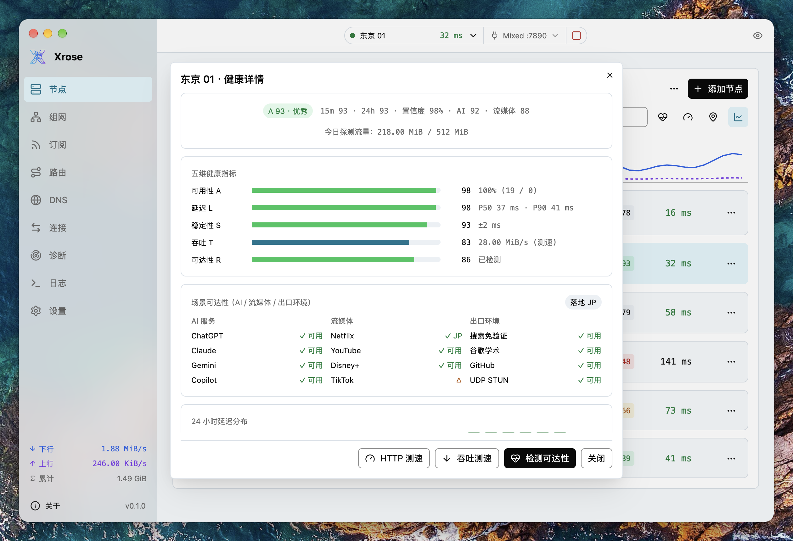
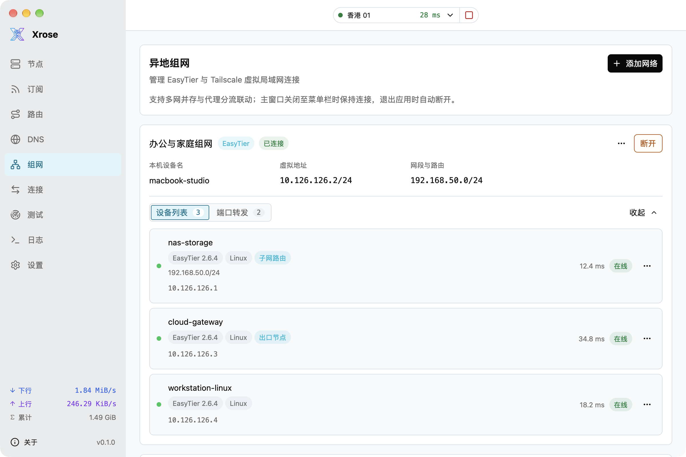
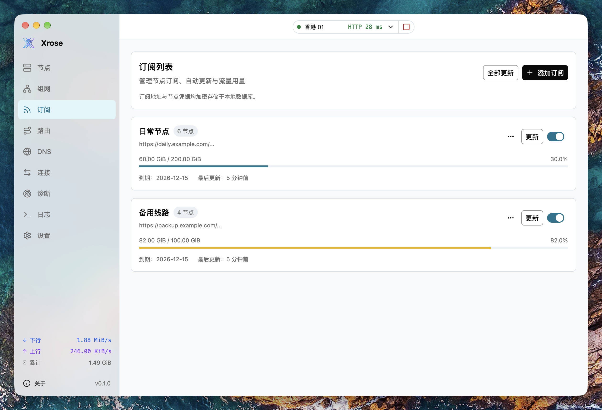
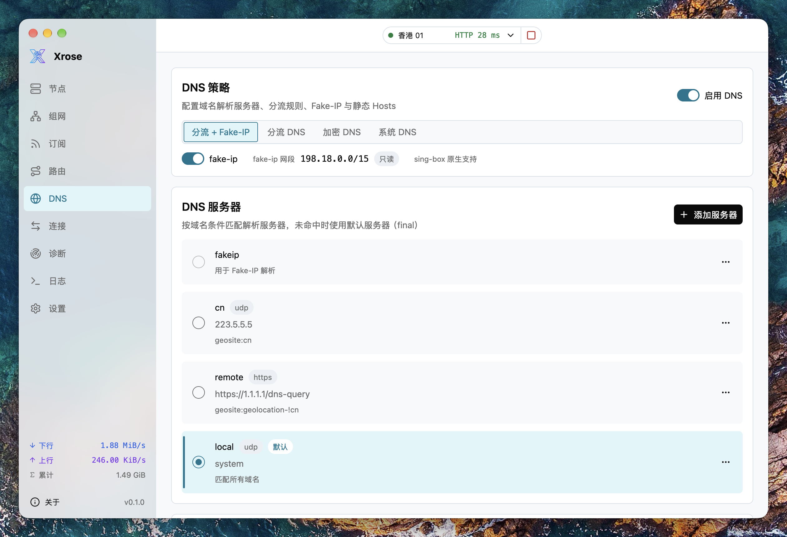
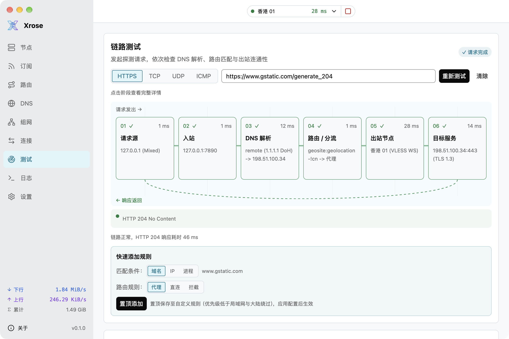
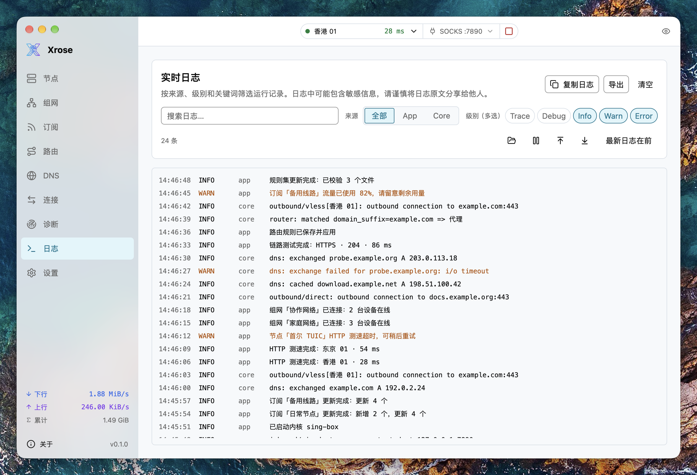
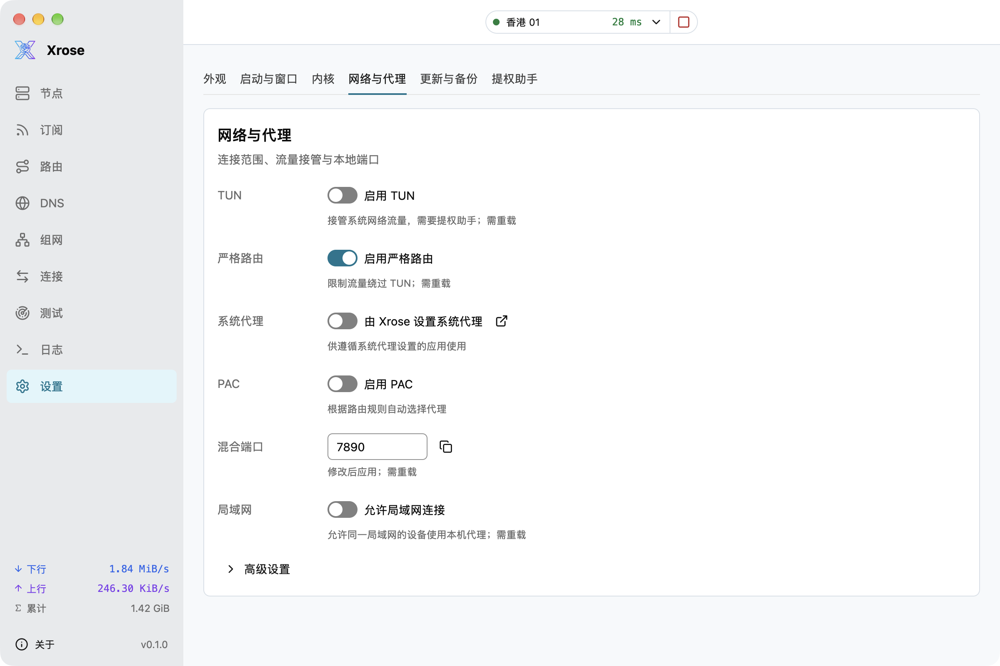
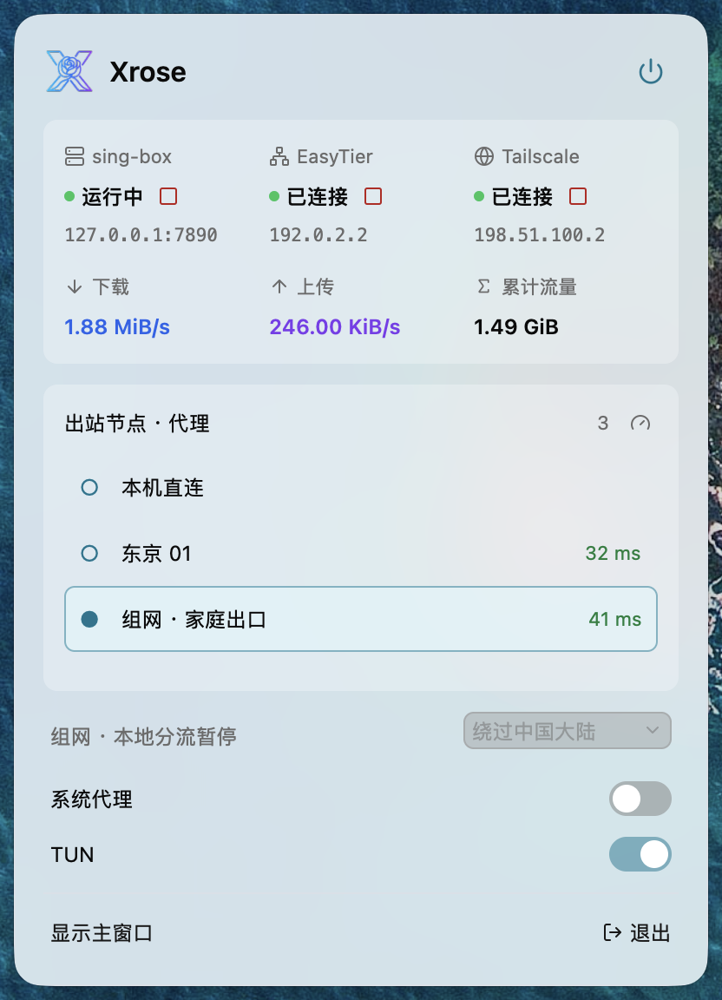

# Xrose

<p align="center">
  
</p>

**Xrose** 是 [Project Xristina](docs/MILESTONE.M1.PROJECT-XRISTINA.md) 旗下的跨平台桌面客户端。

Xrose 基于 Rust 与 GPUI Kit 构建，当前支持 **sing-box** 与 **Xray** 内核，并集成 **EasyTier** 与 **Tailscale** 异地组网，可运行于 Windows、macOS 和 Linux。

Xrose 正式读作 **k'rose**，口语也可读作 **ex-rose**。


## 核心特色

### 界面与交互

- **原生界面与窗口材质**：基于 Rust 与 GPUI Kit 构建，低资源占用，支持 macOS 毛玻璃（vibrancy）、Windows Mica / Mica Alt / Acrylic 与 Linux Wayland 毛玻璃等原生窗口材质。
- **多入口实时同步**：采用两栏布局与顶栏状态胶囊，工作模式、活动节点、内核状态与实时速率在主窗口、顶栏与系统托盘面板间实时同步；支持最小化或关闭窗口驻留托盘。
- **快捷导入与拖拽编排**：自动识别剪贴板中的分享链接、Base64 列表与二维码图片，支持拖拽文件及跨屏框选扫描二维码导入节点或订阅；节点、路由规则与自定义规则分组均支持拖拽排序。
- **实时观测与隐私保护**：连接页提供实时连接明细、进程图标与多维度流量统计图表；开启隐私模式后，界面、剪贴板导出及诊断报告中的节点地址、域名与网络标识会自动遮罩。

<details>
<summary>查看全部页面截图</summary>

**1. 节点**




**2. 组网**



**3. 订阅**



**4. 路由**


**5. DNS**



**6. 连接**


**7. 诊断**



**8. 日志**



**9. 设置**



**10. 托盘浮窗**



**11. 关于**


</details>

### 三种工作模式

Xrose 提供三种独立工作模式，切换时完整保留原有节点、出站组与规则配置：

| 模式 | 适用场景 | 流量与 DNS |
| --- | --- | --- |
| 直连 | 无代理节点时的日常流量监控、去广告与网络诊断 | 本机直接访问，保留阻止规则、加密 DNS、Hosts 与异地组网路由 |
| 代理 | 多协议节点管理与按规则策略分流 | 按本地规则分流至代理节点、出站组、直连、阻止或组网出口 |
| 组网 | 异地虚拟局域网互联与全流量远端出口接管 | 指定组网出口通过 TUN 接管系统流量，默认 DNS 随出口（可选自定义 DNS），暂停本地代理分流 |

### 直连模式


- **开箱即用**：默认使用内置 sing-box 与「本机直连」模式，无需配置节点订阅或代理节点即可开启实时流量监控、连接捕获与网络诊断。
- **广告拦截与 DNS 管理**：直连模式继续应用阻止规则与去广告规则集、直连加密 DNS、Hosts 与异地组网路由，自动跳过依赖代理出站的规则与上游解析器。
- **实时观测与网络诊断**：连接页支持按连接明细或活跃进程查看实时速率与累计流量，可随时断开连接或按域名、进程、IP 创建阻止规则；诊断页提供链路测试、DNS 对比、UDP / NAT 探测及脱敏报告导出。
- **无缝切换代理**：本机直连固定在节点列表、顶栏菜单与托盘首项，可随时切换至代理节点或出站组，保留已有路由模板、出站组与节点选择。

### 代理模式

- **双内核编译与热重载**：统一配置模型可编译为 sing-box（1.12+）与 Xray（1.8+）配置，覆盖主流代理与 VPN 协议；应用配置前执行内核校验，支持配置热重载（默认开启）。
- **节点订阅与路由管理**：支持 Base64、分享链接、Clash YAML、SIP008 与 sing-box JSON 导入及二维码分享；提供故障切换、健康度优先、延迟优先、吞吐优先与手动选择出站组，支持自定义规则分组、规则集更新及 SwitchyOmega / AutoProxy 规则导入。节点页提供本机直连、代理节点与组网出口的统一 HTTP 测速、五维健康度评估及 AI / 流媒体可达性检测。
- **网络接入与数据安全**：支持系统代理、PAC、TUN 模式、局域网独立端口与账号认证，具备异常退出后的系统代理恢复机制；节点凭据、订阅令牌与历史流量统计均采用加密存储。

### 异地组网（EasyTier / Tailscale）

- **双后端集成与共存**：内置 EasyTier 与基于 sing-box 的 Tailscale（支持官方服务及自建控制服务器），支持双后端同时在线，且独立于代理内核运行。
- **出口节点与子网路由**：支持使用远端出口或发布本机为出口节点，支持发布本机子网与访问指定远端子网。
- **系统出口与分流目标**：在节点页选择出口即可进入组网模式；组网出口也可加入出站组作为代理模式的分流目标，两种选择独立保存。远端 Xrose 可按活动配置处理出口分流与 DNS，能力边界见 [组网文档](docs/MESH.md#远端-xrose-出口分流)。
- **双向端口转发**：支持「本机 → 组网」与「组网 → 本机」TCP / UDP 端口转发，连接期间增删与修改规则即时生效，无需重连或发布整个子网。
- **设备发现与配置共享**：支持成员在线探测及出口 / 子网状态展示，同一组网内的 Xrose 设备可通过共享码或无认证模式点对点共享节点、节点订阅、组网配置与自定义规则，并在接收端逐项预览合并。
- **分流联动与权限隔离**：组网运行期间自动为代理配置补充直连、TUN 路由排除、PAC 绕过及 MagicDNS 规则；特权操作由提权助手托管，支持断线自动重连与随应用启动连接。详见 [组网文档](docs/MESH.md)。

## 快速开始

前往本仓库 GitHub **Releases** 页面下载对应平台与架构的安装包（可对照 `SHA256SUMS` 校验完整性）：

- **full 包**：内置 `sing-box` 内核、预置规则集与 `xrose-cli`，推荐初次安装下载，开箱即用。
- **lite 包**：仅含应用更新文件，适合已有内核与规则集的环境升级。各平台包格式与安装细节见[发布说明](docs/RELEASE.md)。

### 初次使用

1. **系统安全拦截放行**（当前未附带商业代码签名，首次打开可能触发拦截）：
   - **macOS（Gatekeeper）**：若提示无法验证开发者或已损坏，可在「系统设置 → 隐私与安全性」点击 **仍要打开**，或拖入「应用程序」后在终端执行 `xattr -dr com.apple.quarantine /Applications/Xrose.app`。
   - **Windows（SmartScreen）**：若弹出“Windows 已保护你的电脑”，点击 **详细信息** → **仍要运行**。
2. **直连或代理启动**：启动后默认处于「本机直连」模式，直接点击顶栏「启动」即可开启流量监控与网络诊断；如需代理分流，在「订阅」或「节点」页导入配置并切换节点即可。
3. **开启 TUN 或组网**：首次启用 TUN 模式或异地组网时，按界面提示安装「提权助手」即可。

### 提权助手（后台常驻）

- **权限隔离**：主界面始终以普通用户权限运行，仅由独立的「提权助手」代为执行创建 TUN 虚拟网卡、异地组网及系统网络配置等高权限操作。
- **后台驻留**：安装或更新时经一次管理员授权后，注册为系统后台服务（Windows 计划任务 / macOS LaunchDaemon / Linux systemd 服务）在后台待命，避免每次使用重复弹窗授权，且仅响应当前用户的本地请求。
- **按需与卸载**：仅使用普通直连或系统代理时无需安装；安装后可随时在「设置 → 提权助手」或「诊断」页启动、更新或彻底卸载。

### 卸载与数据清理

1. **卸载后台项**：删除应用前，先在「设置 → 提权助手」点击 **卸载**（若启用过自启，一并在「设置 → 启动与窗口」关闭「登录时启动应用」），再退出 Xrose。
2. **移除主程序**：macOS 删除 `/Applications/Xrose.app`；Windows 删除解压目录（便携版配置与内核位于同级 `XroseData` 目录，删包即清除）；Linux 执行 `sudo apt remove xrose`、`sudo pacman -R xrose` 或删除 AppImage。
3. **清理残留数据**（如使用 `--home` / `XROSE_HOME` 指定目录，直接删除该目录即可）：
   - **macOS**：`~/Library/Application Support/io.xrose.Xrose`、`~/Library/Caches/io.xrose.Xrose`
   - **Windows**（非便携模式）：`%APPDATA%\xrose\Xrose`、`%LOCALAPPDATA%\xrose\Xrose`
   - **Linux**：`~/.config/xrose`、`~/.local/share/xrose`、`~/.cache/xrose`

### 从源码构建

- **环境要求**：Rust 1.95+，Windows、macOS 或 Linux 桌面。
- **Linux 依赖**：需要 GTK3、`libxkbcommon` 与 `wayland-client`（或 X11）开发库；屏幕二维码捕获还需 Clang、PipeWire、XCB、XRandR、D-Bus、GBM 与 EGL 开发库。
- **macOS 打包**：运行 `scripts/build-macos.sh -r --open` 构建、安装并打开 `Xrose.app`。使用系统通知或授权屏幕录制时，请从应用包启动；`cargo run` 直接运行开发用可执行文件。
- **Windows 构建**：参见 [组网文档 · Windows 构建](docs/MESH.md#windows-构建)。

```bash
cargo run -p xrose-app
```

使用独立数据目录运行或测试（不触碰本机正式配置）：

```bash
XROSE_HOME=/tmp/xrose-demo cargo run -p xrose-app
```

## CLI

`xrose-cli` 为无界面入口，适合脚本化操作与配置检查：

```bash
xrose-cli mode [direct|proxy|mesh]            # 查看或切换工作模式
xrose-cli parse ./subscription.txt            # 解析订阅并列出节点
xrose-cli import ./sub.yaml                   # 导入订阅文件
xrose-cli compile --core sing-box -o c.json   # 编译配置
xrose-cli check --core sing-box               # 使用真实内核校验配置
xrose-cli doctor                              # 输出网卡、路由、DNS、端口与助手诊断
xrose-cli mesh --help                         # 异地组网命令
```

其余子命令见 `xrose-cli --help`。

## 文档

- [异地组网与构建说明](docs/MESH.md)
- [架构与编译约定](docs/ARCHITECTURE.md)
- [节点健康评分机制](docs/NODE-HEALTH.md)
- [UI 规范](docs/DESIGN.md)
- [路线图与里程碑](docs/ROADMAP.md)

## 许可

GPL-3.0-or-later，见 `LICENSE`。GPUI / GPUI Kit 为 Apache-2.0。
