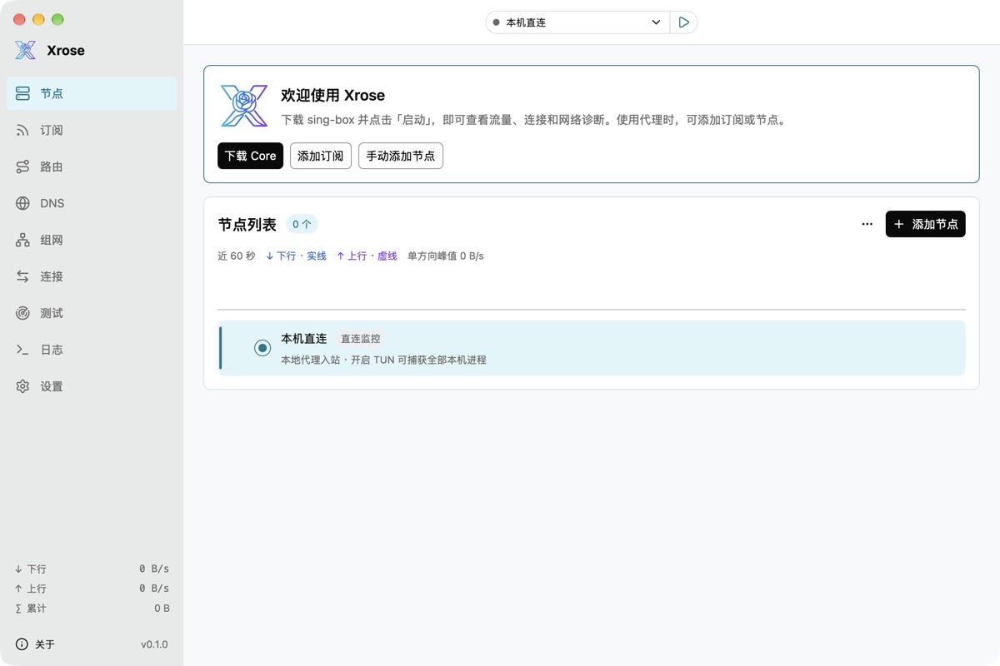

# Xrose

<p align="center">
  
</p>

**Xrose** 是 [Project Xristina](docs/MILESTONE.M1.PROJECT-XRISTINA.md) 旗下的跨平台桌面客户端（Project Xristina 为规划中的自研网络内核项目）。Xrose 基于 Rust 与 GPUI Kit 构建，当前支持 **sing-box** 与 **Xray** 内核，并集成 **EasyTier** 与 **Tailscale** 异地组网，可运行于 Windows、macOS 和 Linux。

Xrose 正式读作 **k'rose**，与英文 **Cross** 谐音，口语也可读作 **ex-rose**，命名致敬 X Japan 的歌曲《ROSE OF PAIN》。


## 核心特色

### 原生界面与交互体验

- **原生渲染与窗口材质**：基于 Rust 与 GPUI Kit 开发，支持 macOS 毛玻璃（vibrancy）、Windows Mica / Mica Alt / Acrylic 等原生窗口材质，提供深浅色跟随系统与中英双语切换。
- **高效的状态同步**：两栏式布局搭配顶栏控制胶囊，节点切换、工作模式切换与内核启停可在页内、顶栏与系统托盘面板间实时同步；托盘面板支持窗口最小化 / 关闭驻留及系统动画适配。
- **零打断导入与拖拽编排**：在节点与订阅页支持剪贴板粘贴（`⌘V` / `Ctrl+V`）与文件拖放，自动识别链接、Base64 列表与二维码图片；在 Xrose 主窗口可用 `⇧⌘S`（macOS）或 `Ctrl+Shift+S`（Windows / Linux）唤起取景框，跨屏扫描并导入节点或订阅；节点、路由规则与自定义分组支持拖拽排序。
- **实时可视化与隐私保护**：分段控件具备平滑指示动效，连接页展示实时速率、进程图标与多维度流量统计图表；开启隐私模式后，界面、剪贴板导出及诊断报告中的节点地址、域名与网络标识会自动遮罩。

### 本机直连模式



- **零节点开箱启动**：默认采用 sing-box 与「本机直连」模式，无需配置订阅或代理节点即可启动内核，直接启用实时流量监控、连接捕获与网络诊断。
- **直连下的拦截与 DNS 生效**：直连模式继续应用阻止规则（轻量应用防火墙与去广告规则集拦截）、直连加密 DNS、Hosts 与异地组网路由，自动跳过依赖代理出站的规则与上游解析器。
- **无损切换代理**：本机直连置顶于节点列表、顶栏菜单与托盘首项；随时可一键切换至代理节点或自动出站组，保留已有分流模板、出站组与节点选择。
- **实时观测与系统诊断**：连接页支持按连接明细或活跃进程查看实时上下行速率与累计流量，可随时断开连接或按域名、进程、IP 创建阻止规则；测试页提供链路测试、多上游 DNS 对比、UDP / NAT 探测，以及免内核启动的系统网络环境检查与脱敏报告导出。

### 异地组网（EasyTier / Tailscale）

- **双后端集成与共存**：内置 EasyTier（静态链接，无需外部可执行文件）与基于独立 sing-box 的 Tailscale（支持官方服务及自建控制服务器），支持双后端同时在线，且独立于代理内核运行。
- **出口节点与子网路由**：支持使用远端出口或发布本机为出口节点，支持发布本机子网与访问指定远端子网。
- **出口融入代理体系**：已连接组网的出口设备可直接作为代理节点加入手动出站组与分流规则，Xray 与 sing-box 均可使用。
- **双向端口转发**：支持「本机 → 组网」与「组网 → 本机」TCP / UDP 端口转发，连接期间增删与修改规则即时生效，无需重连或发布整个子网。
- **设备发现与配置共享**：支持成员在线探测及出口 / 子网状态展示，可在同一组网内的 Xrose 设备间通过共享码或无认证模式点对点共享节点、节点订阅、组网配置与自定义规则，并在接收端逐项预览合并。
- **分流联动与权限隔离**：组网运行期间自动为代理内核注入直连、TUN 路由排除、PAC 绕过及 MagicDNS 规则；特权操作由提权助手托管，支持断线自动重连与随应用启动连接。详见 [组网文档](docs/MESH.md)。

## 其他核心能力

- **双内核对等编排**：统一意图模型同时编译为 sing-box（1.12+）与 Xray（1.8+）配置，覆盖主流代理与 VPN 协议（VLESS、VMess、Trojan、Shadowsocks、Hysteria2、TUIC、AnyTLS、WireGuard、OpenVPN、OpenConnect），不支持的能力自动降级并提示警告；应用配置前执行内核校验，支持按需开启热重载。
- **节点订阅与路由管理**：支持 Base64、分享链接、Clash YAML、SIP008 与 sing-box JSON 导入；单个节点和整个订阅均可通过链接或二维码分享。支持自定义规则分组、规则集更新、SwitchyOmega / AutoProxy 规则导入，以及手动、故障切换、延迟优先与吞吐优先等节点自动切换策略。
- **网络接入与数据安全**：支持系统代理、PAC、TUN 模式、局域网共享端口认证与前置代理；提供系统代理崩溃恢复，节点凭据、订阅令牌与历史流量统计均采用加密存储。

首次配置 sing-box 时，若规则集需要代理才能下载，可先在系统 DNS 下启动「全局代理」，在「设置 → 更新与备份」开启「使用代理更新资源」，然后点击「路由 → 更新全部规则集」。更新按钮左侧的「⋯」可切换规则源或填写自定义下载目录。各行显示更新结果，下载完成后即可切回分流模板。

## 快速开始

首次安装可下载 **full** 包，内含 sing-box、五个规则集和 xrose-cli。已有安装可用 **lite** 更新应用。各平台的包格式与安装方式见[发布说明](docs/RELEASE.md)。

### 运行环境与构建

- **环境要求**：Rust 1.95+，Windows、macOS 或 Linux 桌面。
- **Linux 依赖**：需要 GTK3、`libxkbcommon` 与 `wayland-client`（或 X11）开发库；屏幕二维码捕获还需 Clang、PipeWire、XCB、XRandR、D-Bus、GBM 与 EGL 开发库。
- **macOS 打包**：运行 `scripts/build-macos.sh -r --open` 构建、安装并打开 `Xrose.app`。使用系统通知或授权屏幕录制时，请从应用包启动；`cargo run` 直接运行开发用可执行文件。
- **Windows 构建**：参见 [组网文档 · Windows 构建](docs/MESH.md#windows-构建)。

```bash
cargo run -p xrose-app
```

使用独立数据目录运行或测试（不触碰本机正式配置）：

```bash
XROSE_HOME=/tmp/xrose-demo cargo run -p xrose-app
```

### 初次使用

1. **准备内核**：Xrose 会自动探测系统 `PATH` 中的 `sing-box` / `xray`，也可在「设置 → Core」下载校验版本或指定本地可执行文件。
2. **直连或代理启动**：保持「本机直连」直接点击顶栏「启动」，即可开始流量监控与网络诊断；如需代理，在「订阅」或「节点」页导入配置并切换节点即可。
3. **开启 TUN 或组网**：按界面提示安装「提权助手」后即可启用虚拟网卡与异地组网。

## CLI

`xrose-cli` 为无界面入口，适合脚本化操作与配置检查：

```bash
xrose-cli mode [direct|proxy]                 # 查看或切换工作模式
xrose-cli parse ./subscription.txt            # 解析订阅并列出节点
xrose-cli import ./sub.yaml                   # 导入订阅文件
xrose-cli compile --core sing-box -o c.json   # 编译配置
xrose-cli check --core sing-box               # 使用真实内核校验配置
xrose-cli doctor                              # 输出网卡、路由、DNS、端口与助手诊断
xrose-cli mesh --help                         # 异地组网命令
```

其余子命令见 `xrose-cli --help`。

## 文档

- [异地组网与构建说明](docs/MESH.md)
- [架构与编译约定](docs/ARCHITECTURE.md)
- [UI 规范](docs/DESIGN.md)
- [路线图与里程碑](ROADMAP.md)

## 许可

GPL-3.0-or-later，见 `LICENSE`。GPUI / GPUI Kit 为 Apache-2.0。
