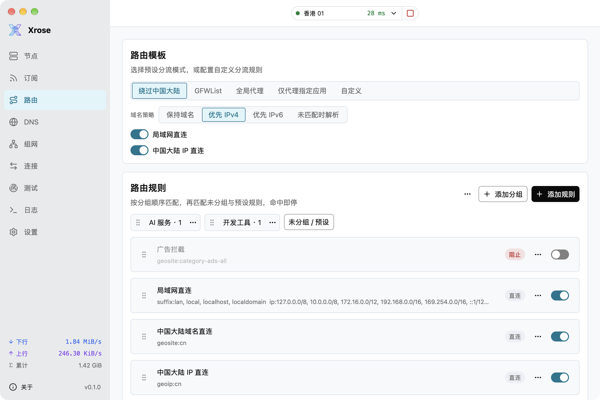

# Xross

<p align="center">
  
</p>

跨平台 Xray / sing-box 桌面客户端，使用 **Rust** 与 **GPUI Kit** 构建。


<table>
  <tr>
    <td></td>
    <td></td>
  </tr>
  <tr>
    <td></td>
    <td></td>
  </tr>
</table>

更多截图：[连接](docs/screenshots/connections.png) · [设置](docs/screenshots/settings.png)

Xross 的核心设计不是"给某个 core 的 JSON 套一层界面"，而是维护一套与 core 无关的
**用户意图模型**（节点、出站组、入站、路由、DNS），再由两个 `CoreAdapter` 编译成
差异极大的 Xray / sing-box 配置。因此第二个 core 不是事后补丁，而是一等公民。

```
┌────────────────────────────── GPUI (xross-app) ──────────────────────────────┐
│  节点 · 订阅 · 路由 · DNS · 连接 · 日志 · 设置       可折叠两栏布局 / 中英双语  │
└───────────────────────────────────┬──────────────────────────────────────────┘
                                    │  AppService（同步 API + 轮询快照）
┌───────────────────────────────────▼──────────────────────────────────────────┐
│                            xross-core                                        │
│  ┌──────────────┐  ┌──────────────┐  ┌─────────────┐  ┌──────────────────┐   │
│  │ AppModel     │─▶│ CoreAdapter  │─▶│ CoreManager │─▶│ xray / sing-box  │   │
│  │ nodes/groups │  │ xray | sbox  │  │ 进程+校验   │  │  run -config     │   │
│  │ routing/dns  │  └──────────────┘  └─────────────┘  └──────────────────┘   │
│  └──────────────┘        │                  │                                │
│  订阅解析 / 分享链接       │ config.json     ├─ stdout/stderr → 滚动日志        │
│  SQLite + 加密           └─ run -test / check└─ Clash API / Xray StatsService   │
└──────────────────────────────────────────────────────────────────────────────┘
```

## 已实现

### 1. Core 管理（`crates/xross-core/src/core/`）

- **二进制管理**：下载 GitHub Release、SHA-256 校验、多版本共存、按平台/架构选择、
  与 App 完全分离（`cores/<core>/<version>/`）。版本清单写入 `manifest.json`；
  支持自定义可执行文件路径覆盖。
- **进程生命周期**：启动/停止/重启、`watchdog` 自动拉起（指数退避、可配置次数）、
  退出码与 stderr 归因（端口占用、配置错误、权限不足、OOM/信号等）。
- **配置生成与校验**：编译 → 写临时配置 → 真实执行 `xray run -test` /
  `sing-box check` → 解析输出中的行号与错误，未通过时拒绝启动。
- **日志**：接入 stdout/stderr、按级别过滤、大小滚动日志文件
  （`xross.log` / `xross.1.log`，可配置上限与保留数）。

> Xray 与 sing-box 都不支持热加载配置。因此"改配置 → 应用"在本项目中就是
> **重启 core**；唯一走 API 的热切换是 sing-box 的 selector 组（Clash API）。

编译器面向 **sing-box 1.12+**（已在 1.14.4 上验证）：使用新式 typed DNS
（`type: https/udp/fakeip/local`）、`route.default_domain_resolver` 与
`action: reject`，不再生成 1.11 及更早版本的 legacy DNS 字段。
Xray 侧已在 1.8.24 上通过 `run -test`。

### 2. 配置编译层（`crates/xross-core/src/adapters/`）

- `AppModel` 以意图建模，不绑定任何 core 的 schema。
- **Xray**：`dokodemo-door` 透明代理、`balancers` + `observatory`（leastPing）、
  `geosite:` / `geoip:` 原生字段、fake-ip 跳过并提示、Stats API 入站与策略。
  没有 mixed 入站（自动拆为 SOCKS + HTTP(port+1)）；没有 TUN；不支持 Hysteria2/TUIC。
- **sing-box**：内建 TUN、`selector` / `urltest`、`.srs` rule-set、
  新版路由动作（`sniff`、`hijack-dns`、`reject`）、typed DNS + fake-ip、Clash API。
  旧版 `geoip`/`geosite` 字段已移除，编译器自动生成 SagerNet rule-set 引用；
  没有 fallback/loadbalance 出站时映射为 urltest/selector 并给出警告。
  启动前预下载缺失的 rule-set，避免 core 在启动阶段因网络问题崩溃。
- 编译结果包含 **warnings**：哪些节点被跳过、哪些语义被降级，都会显示在界面上。

### 3. 订阅与节点

- 定时更新；`ETag` / `If-Modified-Since`；自定义 UA 与请求头；`304` 处理。
- 解析：**Base64**、**v2rayN 分享链接**（vmess / vless / trojan / ss / hysteria2 / tuic）、
  **Clash YAML**（含 proxy-groups）、**SIP008**、**sing-box JSON**。
- 统一 `Node` 模型；分享链接**双向转换**（导入/导出）；二维码（终端块字符渲染）；
  指纹去重；订阅分组导入；排序字段。
- **手动添加节点**：协议（VMess / VLESS / Trojan / Shadowsocks / Hysteria2 / TUIC /
  SOCKS / HTTP）、凭据、TLS / Reality（pbk + shortId）、uTLS 指纹、ALPN、
  传输层（TCP / WebSocket / gRPC / HTTP/2 / HTTPUpgrade）、UDP、标签。
  校验规则集中在 `NodeDraft::into_node`，界面、CLI 与测试共用同一套错误文案。
- 解析 `subscription-userinfo` 响应头，展示已用/总量/到期时间，并可视化进度。

### 4. 路由与 DNS

- 规则编辑器：域名 / 后缀 / 关键字 / 正则 / GeoSite / GeoIP / IP-CIDR /
  进程名 / 端口 / 网络 / rule-set / inbound；动作：直连 / 代理 / 阻止。
- 预设：绕过中国大陆、GFWList、全局、仅代理指定应用、自定义。
- 规则集下载与更新：`.srs` 落盘、ETag 增量、SHA-256 记录、本地优先引用。
- DNS：fake-ip、DoH/DoT/DoQ、按域名分流、hosts、dns-hijack、final server、
  独立的 DNS 校验器（重复 tag、非法网段、final 不存在等）。

### 5. 出站与入站

- 出站组：selector / urltest / fallback / loadbalance；手动切换。
- 入站：mixed / socks / http / TUN / tproxy / redirect；端口、allow LAN、UDP、sniff。
- 系统代理：GNOME `gsettings`、KDE `kioslaverc`、macOS `networksetup`、
  Windows 注册表 + `InternetSetOption`；**崩溃后自动还原**（快照文件）。
- PAC：本地 HTTP 托管 + 动态 PAC 生成，可设为系统自动代理 URL。

### 6. 系统集成

- TUN 使用 sing-box 原生实现；启动前做 `/dev/net/tun`、端口、权限、路由冲突检查。
- **托盘**（Windows `/ macOS`）：状态栏/通知区域 dashboard，包含运行状态、实时速率、
  出站节点与延迟、系统代理、启停 core、全部测速、显示主窗口与退出。
  Windows 用 `Shell_NotifyIcon` + 原生菜单，macOS 用 `NSMenu`；
  **最小化到托盘**与**关闭到托盘**可在设置中分别开关，关闭窗口不再等于退出。
- **提权助手**：GUI 永不提权。安装为 Windows 计划任务（登录时最高权限）/
  macOS LaunchDaemon / Linux systemd service，通过本地 socket（Unix socket /
  Windows 命名管道）以单行 JSON 执行少量操作：TUN 准备、系统 DNS、Linux tproxy 规则。
  Unix 端校验 peer UID；安装/卸载走系统授权（UAC / osascript / pkexec）。
  未安装时 TUN 仍由 core 自行创建，界面明确提示助手状态。
- 开机自启：Linux `.desktop`、macOS LaunchAgent、Windows Run 键；支持 `--minimized`。
- 单实例锁（文件锁 + PID）。

### 7. 运行时

- sing-box / Clash 兼容 API：`/traffic` 数据来自 `/connections` 累计值差分，
  `/connections` 列表、按进程/域名展示、一键断开、`/proxies` 组状态、
  `/proxies/{name}/delay` 真实延迟。
- Xray：`xray api statsquery`（其内部即 gRPC StatsService）解析累计流量；
  连接列表不可得，界面会明确说明。
- 延迟测试：并发 TCP 握手测速、结果缓存（SQLite）、走代理的真实延迟。
- 日志查看器、速率/累计流量曲线（快照轮询）。

### 8. 持久化与安全

- SQLite（WAL）+ 版本化迁移；迁移前自动备份数据库。
- Profile 多配置：新建/切换/重命名/删除；导入/导出 JSON 备份。
- 节点凭据与订阅 token 使用 **ChaCha20-Poly1305** 加密后落库
  （随机 32 字节密钥，0600 权限；也支持 `XROSS_SECRET_KEY`）。
- 桌面通知未接入系统通知中心（当前使用应用内 toast）。

### 9. UI 与更新

- 两栏式布局：可折叠左侧菜单（节点/订阅/路由/DNS/连接/日志/设置），
  右侧内容区；深/浅色主题、跟随系统；中英文切换。
- 托盘 dashboard 与主界面共用同一份快照；菜单动作在 GPUI 主线程 tick 中执行，
  窗口隐藏/恢复不依赖平台私有 API。
- 应用/任务栏图标：Windows 由 `build.rs` 从 256px PNG 生成 `.ico` 并以资源 ID 1 内嵌
  （GPUI 的 Windows 后端按该 ID 加载），macOS 在启动时设置 Dock 图标，Linux 使用
  `WindowOptions.icon` 与随附的 `.desktop` 图标。
- 左侧栏使用系统材质：Windows 为 acrylic（借 GPUI 的 `Blurred` 背景 +
  `theme.tokens.background` 置空，由系统合成器模糊窗口后方内容），macOS 为
  vibrancy，其余平台为不透明面板。系统关闭“透明效果”或版本过低
  （Windows 10 1809 以下）时自动回退，不会出现透出桌面却无模糊的情况。
- 首次启动向导卡片（三步上手）。
- App / core / geo 数据检查与更新；App 更新提供下载页跳转（不做自替换安装）。
- Core 更新：下载 → SHA-256 → 解压 → 安装 → 切换版本，全程不阻塞界面。

## 快速开始

要求：Rust 1.96+（`rust-toolchain.toml` 已固定）、Linux/Wayland 或 X11 桌面。
Linux 需要 GTK3 相关开发库、`libxkbcommon`、`wayland-client`（或 X11 依赖）。

Core 版本：sing-box **1.12+**（推荐 1.14），Xray **1.8+**。

```bash
cargo run -p xross-app          # 启动 GUI
cargo test -p xross-core        # 98 个单元测试
cargo run -p xross-cli -- demo  # 查看编译出的两套配置
```

首次运行：

1. **订阅** 页添加机场订阅，或在 **节点** 页粘贴分享链接 / 点击 **手动** 填写节点。
2. **设置 → Core 管理** 下载 xray 或 sing-box（自动校验 SHA-256）。
3. 右上角 **启动**。修改路由/DNS 后点击 **应用配置**（会重启 core）。

关闭窗口默认最小化到托盘；需要彻底退出请用托盘菜单的 **退出 Xross**，
或在 **设置 → 通用** 关闭“关闭到托盘”（Linux 目前没有托盘，关闭即退出）。

隔离数据目录：

```bash
XROSS_HOME=/tmp/xross-demo cargo run -p xross-app
```

## CLI

`xross-cli` 是同一套核心的无界面入口，便于调试与脚本化：

```bash
xross-cli parse ./subscription.txt          # 自动识别格式并列出节点
xross-cli import ./sub.yaml                 # 导入当前配置
xross-cli compile --core sing-box -o c.json # 仅编译（不启动）
xross-cli check --core sing-box             # 用真实 core 做 check
xross-cli export                            # 导出分享链接
xross-cli add-node --server hk.example.com --protocol vless \
  --uuid 11111111-2222-3333-4444-555555555555 --sni hk.example.com \
  --transport ws --path /ws                       # 手动添加节点
xross-cli helper status                     # 提权助手状态（JSON）
xross-cli helper install                    # 安装并启动助手（会请求管理员权限）
xross-cli helper start|restart|uninstall    # 启停/卸载已安装的助手
xross-cli doctor                            # TUN/端口/权限检查
```

## 测试

```bash
cargo test -p xross-core
```

覆盖：链接解析/导出往返、Clash/SIP008/sing-box 解析、去重、规则匹配、CIDR、
DNS 校验、加密落库、SQLite 迁移与备份、PAC HTTP 服务、日志轮转、进程退出归因、
单实例锁、订阅合并、Profile 切换、两套 adapter 的结构约束、tar.gz 魔数解压、
手动节点草稿校验（UUID/Reality/传输组合）、提权助手协议与状态标签等。

另外做了真实二进制验证：

```
xray 1.8.24:      run -test 通过，StatsService 统计查询正常
sing-box 1.11:    不支持（编译器只生成 1.12+ typed DNS）
sing-box 1.14.4:  check 通过，UI 启动 / Clash API / selector 热切换均验证
```

## 已知限制 / 路线图

- **托盘**：仅 Windows 与 macOS 实现。Linux 暂无 StatusNotifier/AppIndicator
  后端，`available()` 返回 false，关闭窗口仍会退出。
- **Windows 托盘与权限**：`Shell_NotifyIcon` 要求进程完整性级别不低于任务栏。若 exe 位于带
  Low 完整性标签的目录（例如受限构建沙盒），进程会继承 Low IL，向 Medium IL 的任务栏注册
  托盘会得到 `ERROR_ACCESS_DENIED`；应用会退化为“关闭即退出”并记录原因。把程序放到普通
  目录/安装包路径运行即可；若需要就地恢复，可执行
  `icacls <目录> /setintegritylevel (OI)(CI)M`（需要修改 SACL 的权限）后用 `icacls` 确认。
- **移动端**：未实现（无 VPN service / 前台通知 / 快捷磁贴）。
- **提权助手**：安装器已实现（Windows 计划任务 / macOS LaunchDaemon /
  Linux systemd），但 Linux tproxy 规则与 macOS `networksetup` DNS 路径尚未在
  真机上端到端验证；安装/卸载会弹出系统管理员授权。
- **Xray 连接列表**：StatsService 只提供计数，无法列出连接。
- **流量面板**：sing-box 使用 `/connections` 累计值差分；没有连接时图表为空。
- **系统代理**：仅在 GNOME/KDE、macOS、Windows 上生效；其他桌面会明确报错。
- **平台验证**：核心逻辑与 Windows 托盘窗口/菜单/隐藏恢复路径已在本机验证；
  Windows 注册表、`InternetSetOption`、macOS `networksetup`、LaunchDaemon 等代码
  按平台 API 编写，但尚未在真机 CI 上验证。
- **sing-box 版本**：编译器只生成 1.12+ 的 typed DNS；1.11 及更早版本会校验失败。
  这是有意取舍，避免同时维护两套 DNS schema。
- **App 自更新**：只做版本检查与下载页跳转，不做二进制自替换。
- **i18n**：导航、页面标题、主要按钮支持中英双语；部分提示与错误文本仍为中文。
- **WireGuard**：模型已预留协议位，但密钥字段未实现，编译时会给出警告并跳过。
- 系统代理后端在非 GNOME/KDE 的 Linux 桌面上不可用（会明确提示）。

## 目录结构

```
crates/
  xross-core/
    src/model/          # AppModel：节点、组、入站、路由、DNS
    src/adapters/       # xray.rs / singbox.rs：编译为各自 schema
    src/core/           # binary / process / logs
    src/subscription/   # 解析、抓取、分享链接、二维码
    src/runtime/        # Clash API、Xray stats、延迟测试
    src/storage/        # SQLite、迁移、加密
    src/system/         # 系统代理、PAC、自启、单实例、特权助手、TUN 检查
    src/service.rs      # UI 唯一入口（AppService / UiSnapshot）
  xross-app/
    src/ui/             # GPUI 页面（节点/订阅/路由/DNS/连接/日志/设置）
    src/tray/           # dashboard.rs + macos.rs / windows.rs / unsupported.rs
  xross-cli/            # 无界面工具（含 add-node / helper）
```

## 许可

GPL-3.0-or-later（见 `LICENSE`）。GPUI / GPUI Kit 为 Apache-2.0。

品牌资源位于 [crates/xross-app/assets](crates/xross-app/assets)：透明 X/玫瑰标识、
圆角应用图标（512/256/128/96/64）与 `io.xross.Xross.desktop`。桌面环境中安装
desktop 文件与 hicolor 图标后，任务栏/启动器会显示对应 logo：

```bash
install -Dm644 crates/xross-app/assets/io.xross.Xross.desktop \
  ~/.local/share/applications/io.xross.Xross.desktop
install -Dm644 crates/xross-app/assets/icons/xross.png \
  ~/.local/share/icons/hicolor/256x256/apps/xross.png
```
