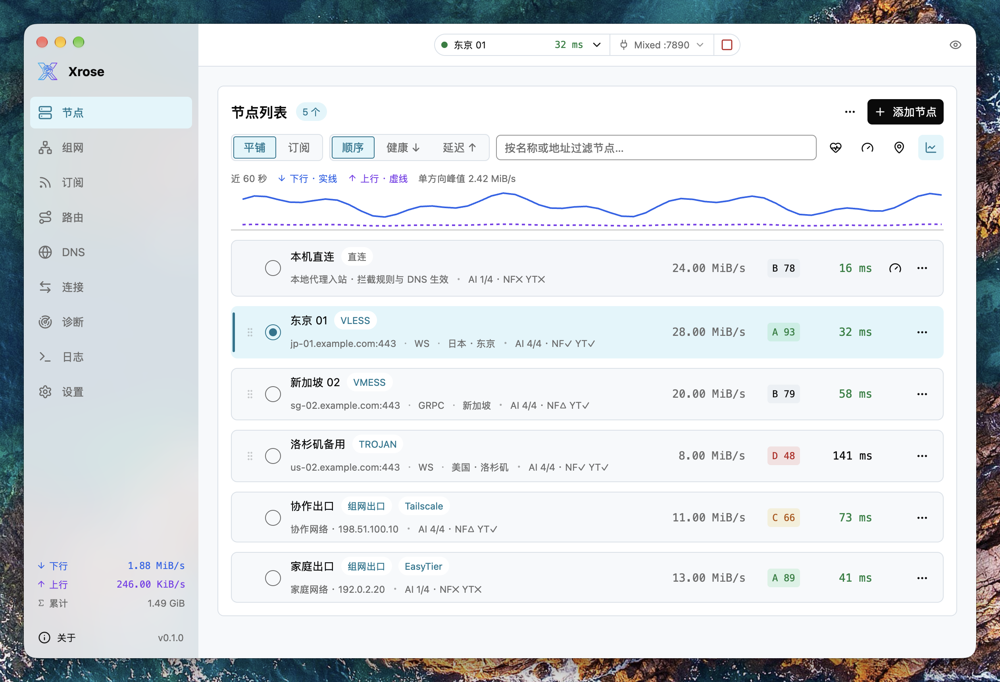
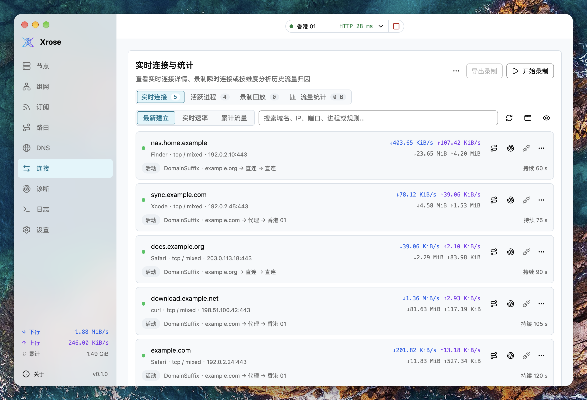
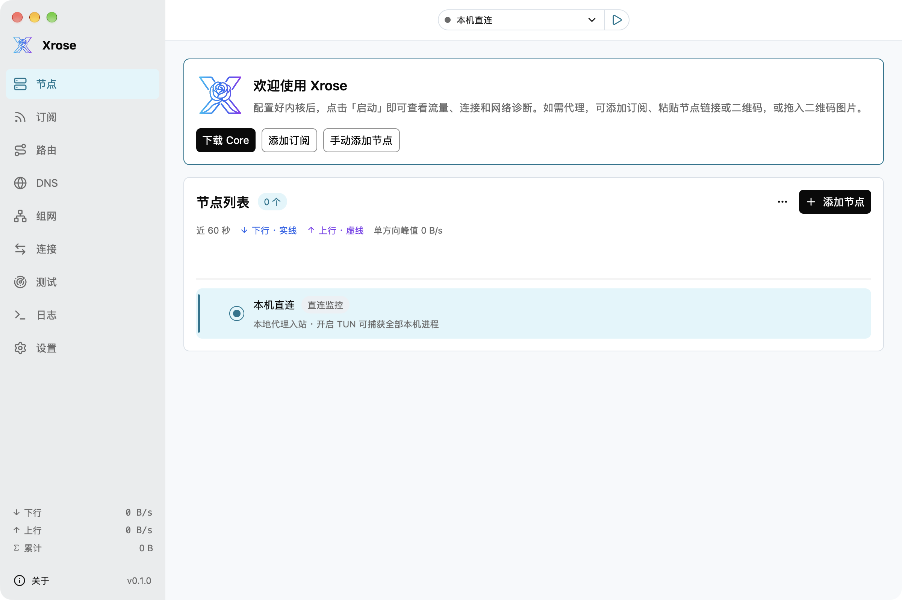
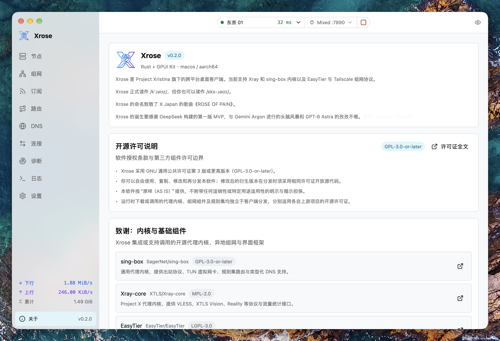

<div align="center">
  

  <h1>Xrose</h1>

  <p>
    <strong>基于 Rust 与 GPUI Kit 构建的跨平台桌面网络客户端</strong><br />
    集 <strong>sing-box / Xray</strong> 双代理内核、<strong>EasyTier / Tailscale</strong> 异地组网、五维节点健康评估与可视化链路诊断于一体
  </p>

  <p>
    <a href="https://github.com/zuoxinyu/xrose/releases">
      
    </a>
    
    
    <a href="LICENSE">
      
    </a>
  </p>

  <p>
    <strong>简体中文</strong> · <a href="README_EN.md">English</a>
  </p>

  <p>
    <a href="#核心特性">核心特性</a> ·
    <a href="#工作模式">工作模式</a> ·
    <a href="#功能概览">功能概览</a> ·
    <a href="#快速开始">快速开始</a> ·
    <a href="#cli">CLI</a> ·
    <a href="#文档">文档</a>
  </p>
</div>

> **Xrose** 是 [Project Xristina](docs/MILESTONE.M1.PROJECT-XRISTINA.md) 旗下的开源跨平台桌面客户端，正式读作 **k'rose**（`/k'ɹəʊz/`），口语也可读作 **ex-rose**（`/ɛks-ɹəʊz/`）。



## 核心特性

- **原生桌面与窗口材质**：基于 Rust 与 GPUI Kit 构建，GPU 渲染、低资源占用；支持 macOS 毛玻璃（vibrancy）、Windows Mica / Mica Alt / Acrylic 与 Linux Wayland 毛玻璃；主窗口、顶栏状态胶囊与跨平台托盘浮窗实时同步。
- **本机直连开箱即用**：内置 `sing-box` 内核与预置规则集，无需节点订阅即可启用实时连接监控、活跃进程流量视图、一键阻止规则、去广告规则集、加密 DNS 与历史流量统计。
- **双内核统一编排与广协议支持**：单一配置同时编译至 **sing-box（1.12+）** 与 **Xray**，覆盖 VLESS（XTLS Vision / Reality）、VMess、Trojan、AnyTLS、Shadowsocks、Hysteria2、TUIC、SOCKS、HTTP、WireGuard、OpenVPN 与 OpenConnect；内置配置校验、失败回滚与热重载。
- **五维节点健康评分与场景可达性检测**：从可用性、延迟（P50 / P90）、稳定性、吞吐与可达性五个维度计算 `A–F` 健康等级及扣分原因，内置 AI 服务、流媒体与出口环境检测，支持按健康评分、延迟、吞吐或故障切换自动切节点。
- **原生融合 EasyTier 与 Tailscale 异地组网**：双组网后端可同时在线且独立于代理内核运行，自动处理与代理 TUN、PAC 及 MagicDNS 的路由共存；支持组网出口接管或分流、远端 Xrose 出口按规则分流、在线双向端口转发与设备间加密配置共享。
- **可视化链路诊断与权限隔离架构**：提供六阶段可视化链路测试，并支持当页一键添加路由规则；主界面始终以普通用户权限运行，TUN 与异地组网由独立「提权助手」按需托管；凭据、订阅令牌、组网密钥与统计记录均采用本地加密存储。

## 工作模式

Xrose 提供三种独立工作模式，切换时完整保留原有节点、出站组与路由规则配置：

| 模式 | 适用场景 | 流量与 DNS |
| --- | --- | --- |
| **直连** | 无节点订阅时的日常流量监控、去广告与网络诊断 | 本机直接访问，保留阻止规则、去广告规则集、直连加密 DNS、Hosts 与异地组网路由 |
| **代理** | 多协议节点管理与按规则策略分流 | 按本地规则分流至代理节点、出站组、直连、阻止或组网出口 |
| **组网** | 异地虚拟局域网互联与全流量远端出口接管 | 指定组网出口通过 TUN 接管系统流量，默认 DNS 随出口（可选自定义 DNS），暂停本地代理分流 |

## 功能概览

### 代理与双内核编排

- **双内核编译与热重载**：统一配置模型自动编译为 sing-box（1.12+，采用新式规则集与类型化 DNS）或 Xray（1.8+，TUN 需 26.6.27+）配置；应用变更前执行内核校验，默认启用热重载，替换失败自动恢复原配置。
- **主流代理、代理链与 VPN 协议**：支持 VLESS（XTLS Vision / Reality）、VMess、Trojan、AnyTLS、Shadowsocks、Hysteria2、TUIC、SOCKS、HTTP、多跳代理链（首跳支持出站组或组网网关，后续 TUIC、Hysteria2 等 UDP 节点需前一跳能向其服务端口转发 UDP），以及 WireGuard、OpenVPN 与 OpenConnect（OpenVPN / OpenConnect 需 sing-box 1.14+）。
- **快捷导入与拖拽编排**：支持 Base64、分享链接、Clash YAML、SIP008 与 sing-box JSON 导入及二维码分享；自动识别剪贴板内容，支持文件/图片拖放与跨屏框选扫描二维码（`Ctrl+Shift+S` / `⇧⌘S`）；支持 SwitchyOmega / AutoProxy 规则导入，以及节点、路由规则与自定义规则分组拖拽排序。
- **网络接入与保护**：支持系统代理、PAC、TUN 模式、局域网独立端口与账号认证，具备异常退出后的系统代理自动恢复机制。

### 节点健康评分与自动切换

- **统一五维评估**：对本机直连、代理节点与已连接组网出口提供统一 HTTP 测速、吞吐测速与五维健康度评分（可用性 `A`、延迟 `L`、稳定性 `S`、吞吐 `T`、可达性 `R`），展示 `A–F` 综合等级与逐项扣分说明。
- **场景可达性检测**：一键校验 **AI 服务**（ChatGPT、Claude、Gemini、Copilot）、**流媒体**（Netflix、YouTube、Disney+、TikTok）与 **出口环境**（搜索免验证、谷歌学术、GitHub、UDP STUN）。
- **出站组自动切换**：支持手动选择、仅故障切换、延迟优先、吞吐优先与健康评分优先，可按出站组配置故障回退范围（组内全部 / 同订阅 / 同地区）、连续失败次数与检查间隔。详见 [节点健康评分机制](docs/NODE-HEALTH.md)。

### 异地组网（EasyTier / Tailscale）

- **双后端集成与共存**：内置 EasyTier 与独立 Tailscale 组件（支持官方服务及自建 Headscale），支持双后端同时在线，独立于代理内核运行，并自动为代理配置补充直连、TUN 路由排除、PAC 绕过及 MagicDNS 规则。
- **出口与子网路由**：支持发布或接入出口节点与子网路由；在节点页选择组网出口即可进入组网模式，组网出口也可加入出站组作为代理模式的分流目标，两种选择独立保存；远端 Xrose 出口可按其活动配置对转发流量执行规则分流与 DNS 策略（边界见 [组网文档](docs/MESH.md#远端-xrose-出口分流)）。
- **在线双向端口转发**：支持「本机 → 组网」与「组网 → 本机」TCP / UDP 端口转发，连接期间增删与修改规则即时生效。
- **设备发现与点对点配置共享**：支持成员在线状态、出口/子网标签与设备连通性探测；同组网内的 Xrose 设备可通过共享码或无认证模式点对点共享节点、节点订阅、组网配置与自定义规则，并在接收端逐项预览合并。详见 [异地组网文档](docs/MESH.md)。

### 实时观测与可视化诊断

- **实时连接、失败记录与活跃进程**：提供实时连接明细、失败/挂起/被拦截连接捕获、附带应用图标的活跃进程聚合视图与会话录制回放；支持断开连接、一键按主域或精确目标修复，或批量勾选创建路由规则。
- **多维度流量统计**：按节点、进程与主域名维度统计代理与直连流量归因（默认关闭，按需开启），支持运行以来 / 日 / 周 / 月区间及条形图 / 表格视图。
- **六阶段链路测试**：支持 HTTPS / TLS（可指定原 IP 与 SNI）/ TCP / UDP / ICMP 探测，依次呈现 **请求源 → 入站 → DNS 解析 → 路由 / 分流 → 出站节点 → 目标服务**，点击各阶段可查看完整详情并在当页一键置顶添加规则；同时提供多解析器 DNS 并发对比、UDP / NAT 探测与脱敏诊断报告导出。

### 托盘浮窗与隐私保护

- **跨平台托盘浮窗**：集中展示代理内核、EasyTier 与 Tailscale 运行状态、实时速率，提供节点快速切换、近期失败连接计数与一键修复、路由模板、系统代理与 TUN 开关；支持最小化或关闭主窗口驻留托盘。
- **全局隐私模式**：一键开启后，自动遮罩界面、剪贴板导出及诊断报告中的节点地址、域名、网络标识与流量归因信息。

### 界面预览

| 五维健康详情与可达性检测 | 六阶段可视化链路诊断 |
| :---: | :---: |
|  |  |

| EasyTier / Tailscale 异地组网 | 实时连接、活跃进程与流量统计 |
| :---: | :---: |
|  |  |

<details>
<summary>展开查看其余页面截图（直连、订阅、路由、DNS、日志、设置、托盘浮窗、关于）</summary>

**本机直连**



**订阅**


**路由**


**DNS**


**日志**


**设置**


**托盘浮窗**

<p align="center">
  
</p>

**关于**



</details>

## 快速开始

### 包管理器安装（推荐）

两种方式均自动安装 **full 包**（内置 `sing-box` 内核、预置规则集与 `xrose-cli`）：

**macOS（Homebrew）**

```bash
brew tap zuoxinyu/tap
brew install --cask zuoxinyu/tap/xrose
```

**Windows（Scoop）**

```powershell
scoop bucket add xrose https://github.com/zuoxinyu/scoop-bucket
scoop install xrose/xrose
```

### 手动下载安装

前往 [GitHub Releases](https://github.com/zuoxinyu/xrose/releases) 下载对应平台与架构的安装包，并可对照 `SHA256SUMS` 校验完整性：

| 平台 | 格式 | 架构 |
| --- | --- | --- |
| macOS | DMG | Apple Silicon、Intel |
| Windows | ZIP（便携目录 `XroseData`） | x64、ARM64 |
| Linux | AppImage、`.deb` | x86_64、aarch64 |
| Arch Linux | `.pkg.tar.zst` | x86_64 |

- **full 包**：内置 `sing-box` 内核、预置规则集与 `xrose-cli`，推荐初次安装下载，开箱即用。
- **lite 包**：仅含应用更新文件，适合已有内核与规则集的环境升级。各平台安装细节见 [发布说明](docs/RELEASE.md)。

### 初次使用

1. **启动直连监控**：首次打开默认处于「本机直连」模式，点击顶栏「启动」即可开启流量监控、连接观测与网络诊断。
2. **接入代理节点**：在「订阅」或「节点」页通过链接、文件拖放或屏幕扫码导入配置，在节点页或顶栏切换节点即可进入代理模式。
3. **按需启用 TUN / 异地组网**：首次开启 TUN 模式或连接异地组网时，按界面提示安装一次「提权助手」即可。

<details>
<summary>系统安全拦截放行（macOS Gatekeeper / Windows SmartScreen）</summary>

当前发布包未附带商业代码签名，首次打开可能触发系统拦截：

- **macOS（Gatekeeper）**：在「系统设置 → 隐私与安全性」点击 **仍要打开**，或拖入「应用程序」后在终端执行：
  ```bash
  xattr -dr com.apple.quarantine /Applications/Xrose.app
  ```
- **Windows（SmartScreen）**：在提示窗口点击 **详细信息** → **仍要运行**。

</details>

<details>
<summary>提权助手说明（权限隔离与后台常驻）</summary>

- **权限隔离**：主界面始终以普通用户权限运行，仅由独立的「提权助手」代为执行创建 TUN 虚拟网卡、异地组网及系统网络配置等高权限操作。
- **后台驻留**：安装或更新时经一次管理员授权后注册为系统后台服务（Windows 计划任务 / macOS LaunchDaemon / Linux systemd 服务），避免每次使用重复弹窗授权，且仅响应当前用户的本地请求。
- **按需与卸载**：仅使用普通直连或系统代理时无需安装；安装后可随时在「设置 → 提权助手」或「诊断」页启动、更新或卸载。

</details>

<details>
<summary>卸载与数据清理</summary>

1. **卸载后台项**：删除应用前，先在「设置 → 提权助手」点击 **卸载**（若启用过自启，一并在「设置 → 启动与窗口」关闭「登录时启动应用」），再退出 Xrose。
2. **移除主程序**：macOS 删除 `/Applications/Xrose.app`；Windows 删除解压目录（便携版数据位于同级 `XroseData` 目录，删包即清除）；Linux 执行 `sudo apt remove xrose`、`sudo pacman -R xrose` 或删除 AppImage。
3. **清理残留数据**（如使用 `--home` / `XROSE_HOME`，直接删除该目录即可）：
   - **macOS**：`~/Library/Application Support/io.xrose.Xrose`、`~/Library/Caches/io.xrose.Xrose`
   - **Windows**（非便携模式）：`%APPDATA%\xrose\Xrose`、`%LOCALAPPDATA%\xrose\Xrose`
   - **Linux**：`~/.config/xrose`、`~/.local/share/xrose`、`~/.cache/xrose`

</details>

<details>
<summary>从源码构建</summary>

- **环境要求**：Rust 1.95+，Windows、macOS 或 Linux 桌面环境。
- **Linux 依赖**：需要 GTK3、`libxkbcommon` 与 `wayland-client`（或 X11）开发库；屏幕二维码扫描另需 Clang、PipeWire、XCB、XRandR、D-Bus、GBM 与 EGL 开发库。
- **macOS 打包**：运行 `scripts/build-macos.sh -r --open` 构建、安装并打开 `Xrose.app`（涉及系统通知或屏幕录制权限时，请从应用包启动）。
- **Windows 构建**：参见 [组网文档 · Windows 构建](docs/MESH.md#windows-构建)。

```bash
cargo run -p xrose-app
```

使用独立数据目录运行或测试（不影响本机正式配置）：

```bash
XROSE_HOME=/tmp/xrose-demo cargo run -p xrose-app
```

</details>

## CLI

`xrose-cli` 为无界面入口，适合脚本化操作、配置校验与环境诊断：

```bash
xrose-cli mode [direct|proxy|mesh]            # 查看或切换工作模式
xrose-cli parse ./subscription.txt            # 解析订阅并列出节点
xrose-cli import ./sub.yaml                   # 导入节点或订阅文件
xrose-cli compile --core sing-box -o c.json   # 编译目标内核配置
xrose-cli check --core sing-box               # 使用真实内核校验配置
xrose-cli health                              # 查看节点五维健康评分摘要
xrose-cli trace https://example.com           # 执行链路追踪测试
xrose-cli doctor                              # 输出网卡、路由、DNS、端口与助手诊断
xrose-cli mesh --help                         # 异地组网子命令
```

完整子命令与参数见 `xrose-cli --help`。

## 文档

- [异地组网与构建说明](docs/MESH.md)
- [架构与编译约定](docs/ARCHITECTURE.md)
- [节点健康评分机制](docs/NODE-HEALTH.md)
- [桌面发布与打包说明](docs/RELEASE.md)
- [UI 规范](docs/DESIGN.md)
- [路线图与里程碑（Project Xristina）](docs/ROADMAP.md)

## 开源许可与致谢

- Xrose 采用 **GPL-3.0-or-later** 许可协议，详见 [LICENSE](LICENSE)。
- 界面框架基于 GPUI / GPUI Kit（Apache-2.0）；运行时调用的 `sing-box`、`Xray-core`、`EasyTier`、`Tailscale` 及预置规则集均适用各自上游项目的开源许可证。
