<div align="center">
  

  <h1>Xrose</h1>

  <p>
    <strong>A native cross-platform desktop networking client built with Rust and GPUI Kit</strong><br />
    Unifies <strong>sing-box &amp; Xray</strong> proxy cores, <strong>EasyTier &amp; Tailscale</strong> mesh networking, five-dimension node health scoring, and visual link diagnostics
  </p>

  <p>
    <a href="https://github.com/zuoxinyu/xrose/releases">
      
    </a>
    
    
    <a href="LICENSE">
      
    </a>
  </p>

  <p>
    <a href="README.md">简体中文</a> · <strong>English</strong>
  </p>

  <p>
    <a href="#highlights">Highlights</a> ·
    <a href="#work-modes">Work Modes</a> ·
    <a href="#features">Features</a> ·
    <a href="#quick-start">Quick Start</a> ·
    <a href="#cli">CLI</a> ·
    <a href="#documentation">Documentation</a>
  </p>
</div>

> **Xrose** is an open-source cross-platform desktop client from [Project Xristina](docs/MILESTONE.M1.PROJECT-XRISTINA.md). It is officially pronounced **k'rose** (`/k'ɹəʊz/`), and can also be pronounced **ex-rose** (`/ɛks-ɹəʊz/`).

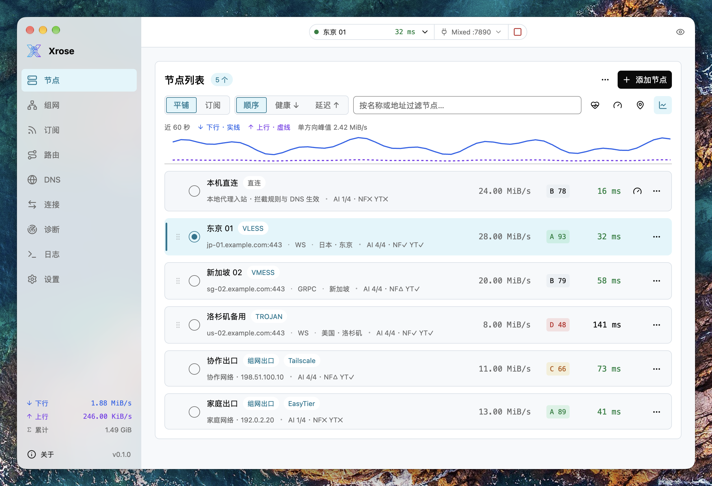

## Highlights

- **Native Desktop UI & Window Materials**: Built with Rust and GPUI Kit for GPU-accelerated rendering and low resource usage. Supports native translucency on macOS (vibrancy), Windows (Mica / Mica Alt / Acrylic), and Linux Wayland blur, with live state synchronization across the main window, title-bar status capsule, and cross-platform tray flyout.
- **Direct Mode Ready Out of the Box**: Ships with a bundled `sing-box` core and preset rule sets. Even without any subscription or proxy node, Xrose launches directly into **Direct** mode for live connection monitoring, per-process traffic inspection, one-click blocking rules, ad-blocking rule sets, encrypted DNS, and traffic statistics.
- **Dual-Core Orchestration & Broad Protocol Coverage**: Compiles one unified configuration to either **sing-box (1.12+)** or **Xray**, covering VLESS (XTLS Vision / Reality), VMess, Trojan, AnyTLS, Shadowsocks, Hysteria2, TUIC, SOCKS, HTTP, WireGuard, OpenVPN, and OpenConnect, with pre-apply core validation, hot reload, and automatic rollback on failure.
- **Five-Dimension Node Health & Reachability Probes**: Evaluates direct, proxy, and mesh exits across Availability, Latency (P50 / P90), Stability, Throughput, and Reachability to produce an explainable `A–F` grade with deduction breakdowns. Includes built-in reachability checks for AI services, streaming platforms, and egress environments, plus health-aware auto-switching.
- **Native EasyTier & Tailscale Mesh Integration**: Runs both mesh backends concurrently and independently of the proxy core while automatically managing coexistence routes, TUN exclusions, PAC bypasses, and MagicDNS. Supports system-wide exit takeover, mesh exits as proxy routing targets, rule-based routing on remote Xrose exits, live bidirectional port forwarding, and encrypted peer-to-peer config sharing.
- **Visual Link Trace & Privilege-Isolated Architecture**: Provides an interactive 6-stage visual link trace with one-click rule creation on the same screen. The GUI always runs unprivileged while an isolated **Privilege Helper** handles TUN, mesh, and system network changes on demand; credentials, subscription tokens, mesh keys, and traffic stats are encrypted locally.

## Work Modes

Xrose provides three independent work modes and preserves your existing nodes, outbound groups, and routing rules when switching between them:

| Mode | Use Case | Traffic & DNS |
| --- | --- | --- |
| **Direct** | Daily traffic monitoring, ad blocking, and network diagnostics without proxy subscriptions | Direct outbound traffic while retaining block rules, ad-blocking rule sets, encrypted direct DNS, Hosts, and mesh routes |
| **Proxy** | Multi-protocol node management and rule-based traffic routing | Routes traffic according to local rules to proxy nodes, outbound groups, direct, reject, or mesh exits |
| **Mesh** | Virtual LAN connectivity and full-traffic routing through a remote mesh exit | Routes system traffic through a selected mesh exit via TUN; DNS follows the exit by default (or uses custom DNS) while pausing local proxy rules |

## Features

### Proxy & Dual-Core Orchestration

- **Dual-Core Compilation & Hot Reload**: Compiles a single core-agnostic configuration into sing-box (1.12+, modern `.srs` rule sets and typed DNS) or Xray (1.8+; TUN requires 26.6.27+). Validates candidate configs with the selected core before swapping, enables hot reload by default, and restores the previous config if a reload fails.
- **Proxy & VPN Protocols**: Supports VLESS (XTLS Vision / Reality), VMess, Trojan, AnyTLS, Shadowsocks, Hysteria2, TUIC, SOCKS, HTTP, WireGuard, OpenVPN, and OpenConnect (OpenVPN / OpenConnect require sing-box 1.14+).
- **Fast Import & Drag-and-Drop Organization**: Imports Base64 lists, share links, Clash YAML, SIP008, and sing-box JSON, and generates QR codes for sharing. Detects clipboard links/images automatically, accepts drag-and-drop files, offers a cross-monitor screen QR viewfinder (`Ctrl+Shift+S` / `⇧⌘S`), imports SwitchyOmega / AutoProxy rule lists, and supports drag-and-drop ordering for nodes, rules, and custom rule groups.
- **Flexible Network Access**: Supports System Proxy, PAC, TUN mode, dedicated LAN ports, and authentication, with automatic system proxy restoration after unexpected exits.

### Node Health Scoring & Auto-Switch

- **Unified Five-Dimension Scoring**: Runs unified HTTP latency tests, throughput tests, and five-dimension health scoring across Direct, proxy nodes, and connected mesh exits — measuring Availability (`A`), Latency (`L`), Stability (`S`), Throughput (`T`), and Reachability (`R`) with `A–F` grades and itemized deduction explanations.
- **Scenario Reachability Checks**: Verifies **AI services** (ChatGPT, Claude, Gemini, Copilot), **Streaming** (Netflix, YouTube, Disney+, TikTok), and **Egress environment** (captcha-free search, Google Scholar, GitHub, UDP STUN).
- **Per-Group Auto-Switch Policies**: Supports Manual selection, Failover only, Lowest latency, Highest throughput, and Health score priority, with configurable fallback scope (entire group / same subscription / same region), consecutive failure thresholds, and check intervals. See [Node Health Scoring](docs/NODE-HEALTH.md).

### Mesh Networking (EasyTier & Tailscale)

- **Dual Backends Running Together**: Integrates EasyTier (built-in) and Tailscale (official control server or self-hosted Headscale) concurrently and independently of the proxy core, automatically injecting direct routes, TUN exclusions, PAC bypasses, and MagicDNS rules.
- **Exit Nodes & Subnet Routing**: Supports advertising or using exit nodes and subnet routes. Selecting a mesh exit from the Nodes view enters Mesh mode, while mesh exits can also be added to outbound groups as routing targets in Proxy mode without overwriting each other. A remote Xrose exit can apply its active routing and DNS configuration to forwarded exit traffic (see [Remote Xrose Exit Routing](docs/MESH.md#远端-xrose-出口分流)).
- **Live Bidirectional Port Forwarding**: Configures both `Local → Mesh` and `Mesh → Local` TCP/UDP port forwards that take effect immediately without reconnecting.
- **Peer Discovery & P2P Config Sharing**: Displays peer online status, exit/subnet badges, and peer connectivity probes. Xrose devices on the same mesh can share nodes, subscriptions, mesh profiles, and custom rules via one-time share codes or open mode, with per-item diff previews before merging. See [Mesh Documentation](docs/MESH.md).

### Live Observation & Visual Diagnostics

- **Live Connections & Active Processes**: Inspects active connections, per-process live bandwidth and connection counts with application icons, and session recording/replay. Supports closing connections at any time and creating top-priority block rules by domain, process, or IP in one click.
- **Multi-Dimensional Traffic Statistics**: Optional local traffic attribution by node, process, or main domain across session, daily, weekly, and monthly windows in bar chart or table views.
- **6-Stage Visual Link Trace**: Probes HTTPS, TCP, UDP, or ICMP targets and visualizes each stage — **Request Source → Inbound → DNS Resolution → Routing / Rules → Outbound Node → Target Service** — with expandable stage details and inline top-priority rule creation. Includes concurrent DNS A/AAAA comparison, UDP / NAT probing, environment checks, and redacted diagnostic report export.

### Tray Flyout & Privacy Mode

- **Cross-Platform Tray Flyout**: Displays proxy core, EasyTier, and Tailscale status alongside live throughput, quick node switching, routing presets, and System Proxy / TUN toggles, with minimize- or close-to-tray support.
- **Global Privacy Mode**: Toggles instant masking of node addresses, domains, mesh identifiers, and traffic attribution names across the UI, clipboard exports, and diagnostic reports.

### Screenshots

| Five-Dimension Node Health & Reachability | 6-Stage Visual Link Diagnostics |
| :---: | :---: |
| 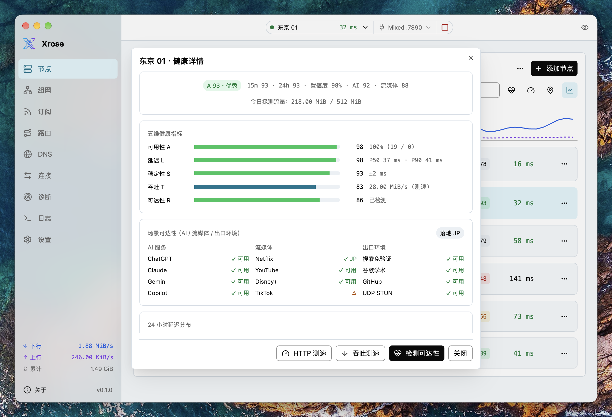 | 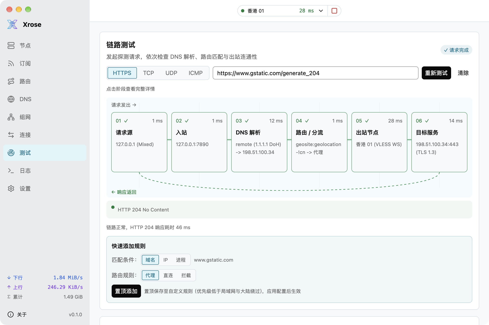 |

| EasyTier & Tailscale Mesh Networking | Live Connections, Processes & Traffic Stats |
| :---: | :---: |
| 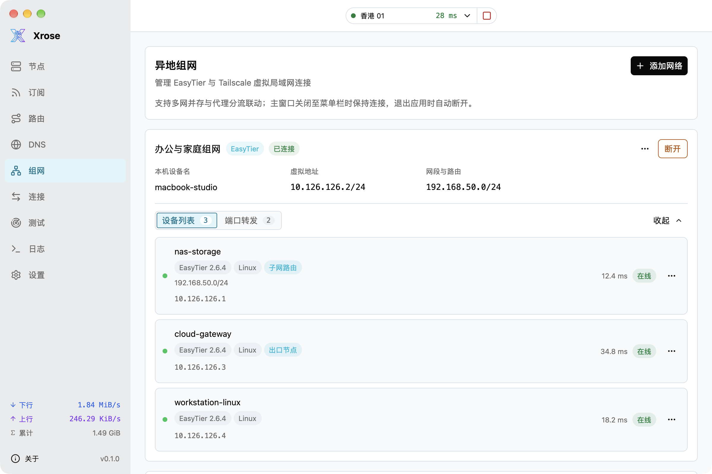 | 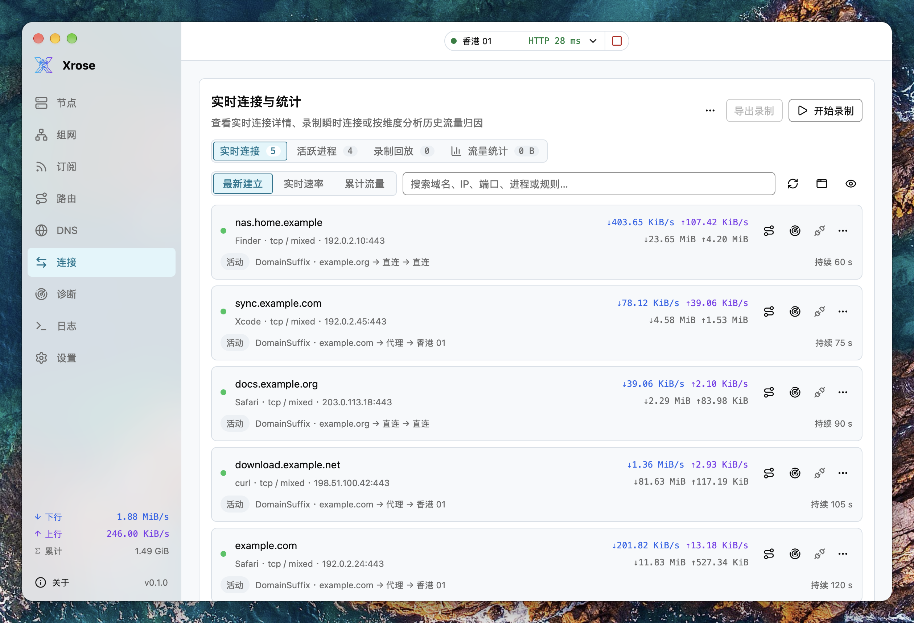 |

<details>
<summary>Show all additional screenshots (Direct, Subscriptions, Routing, DNS, Logs, Settings, Tray Flyout, About)</summary>

**Direct Mode**

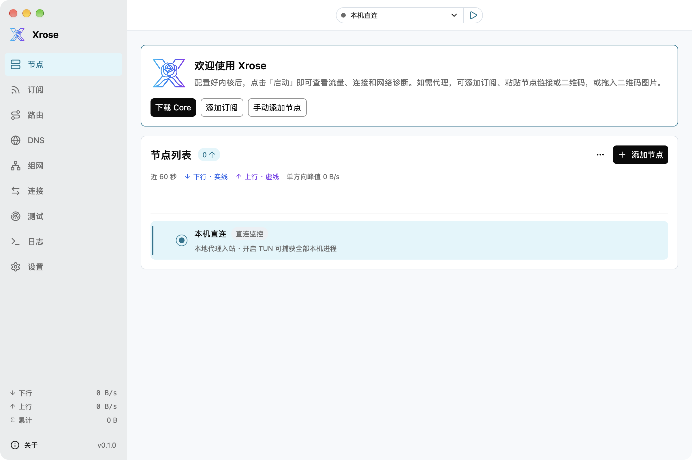

**Subscriptions**

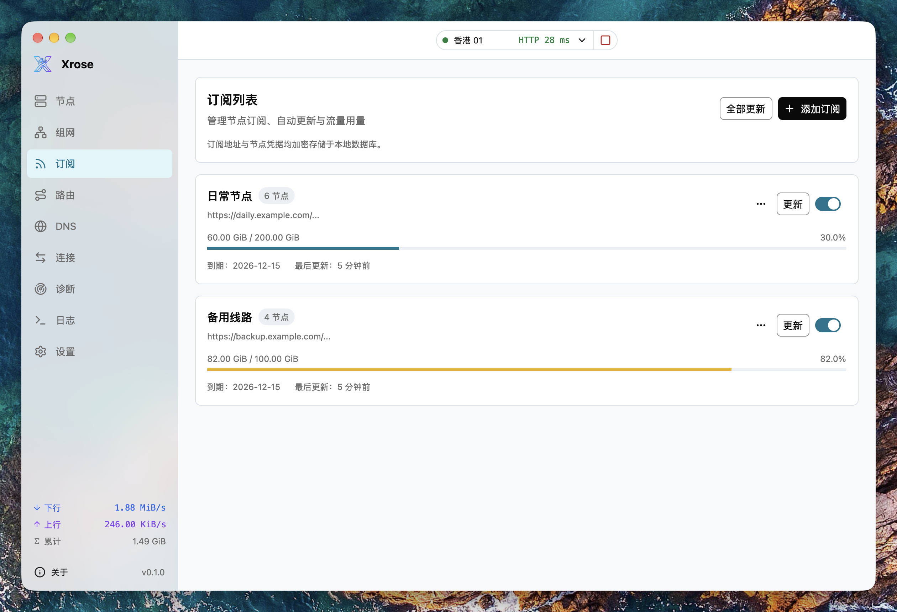

**Routing**

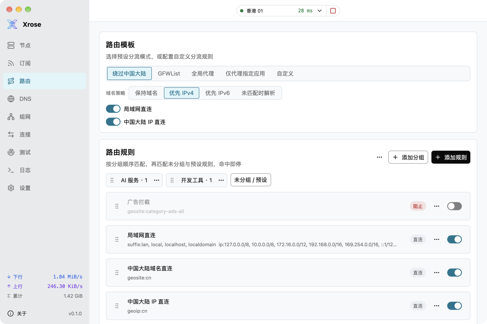

**DNS**

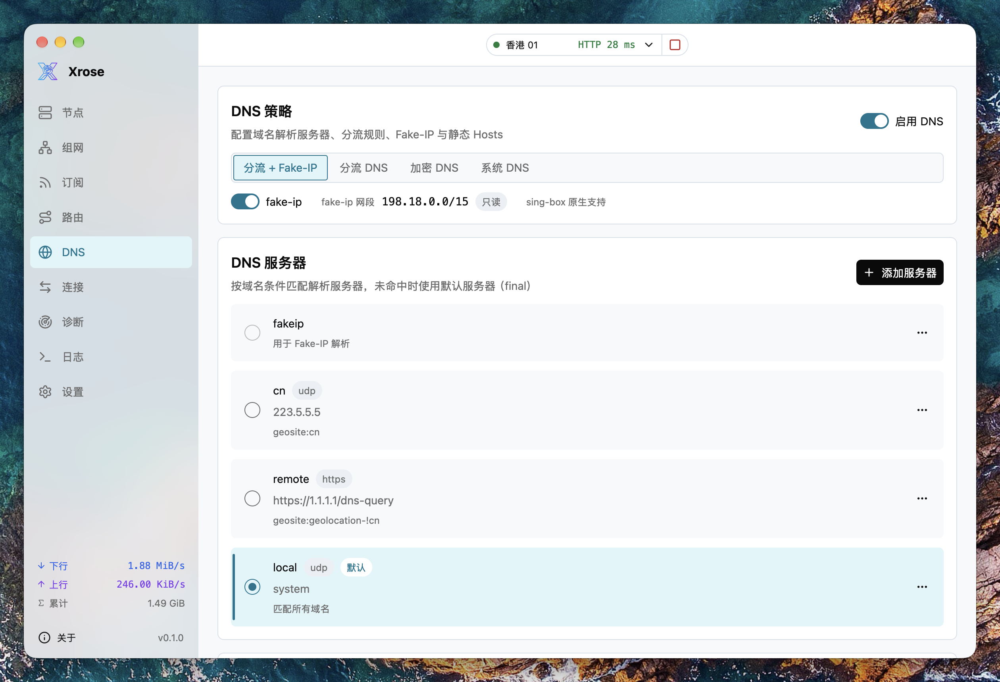

**Logs**

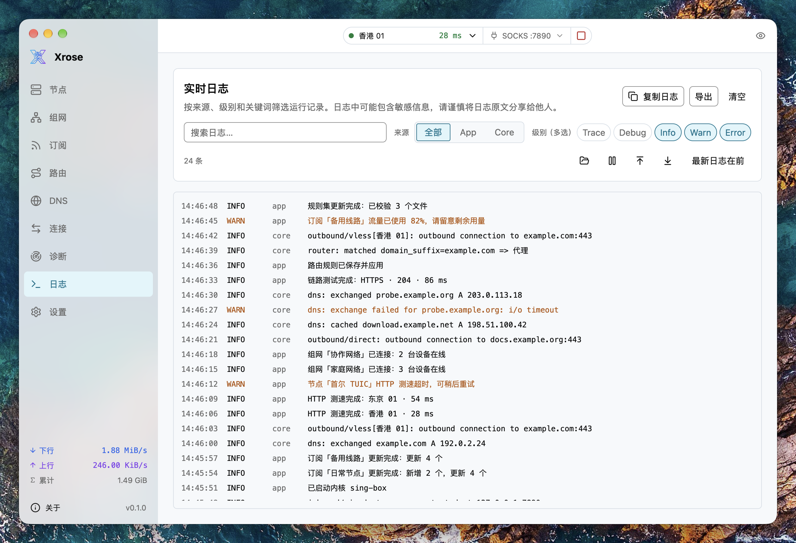

**Settings**

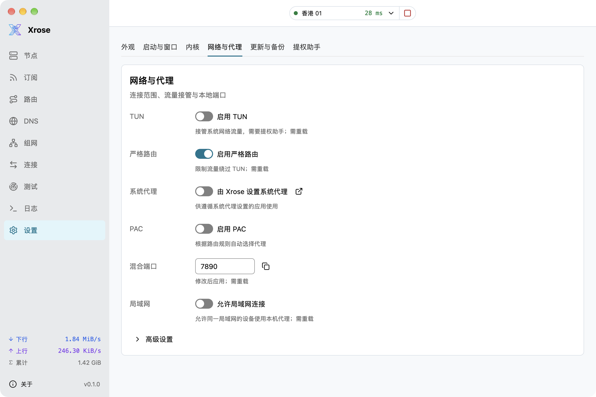

**Tray Flyout**

<p align="center">
  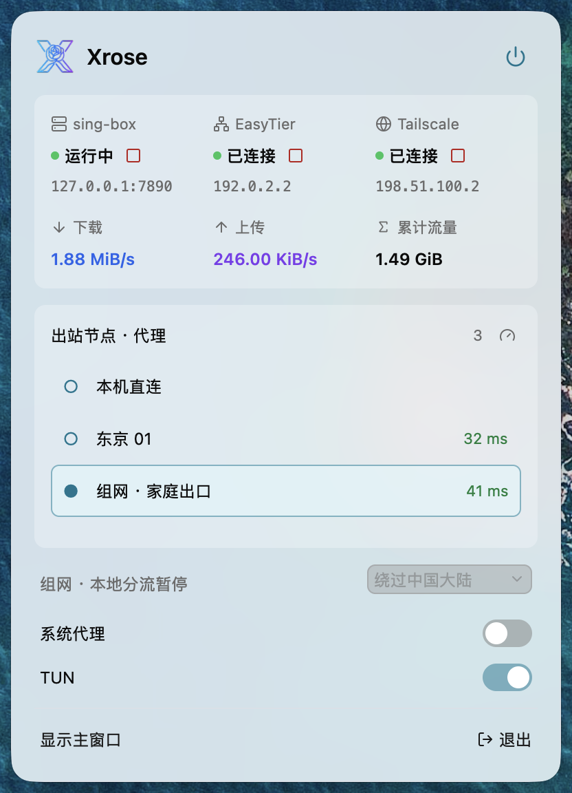
</p>

**About**

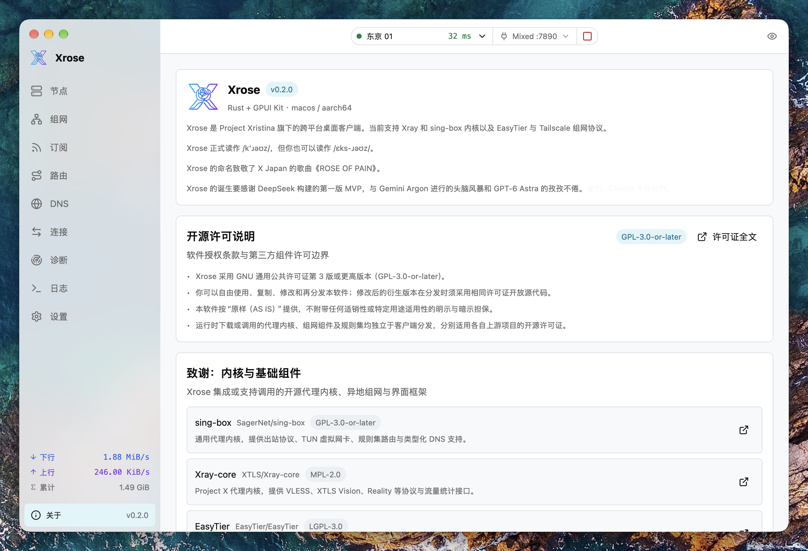

</details>

## Quick Start

### Install via Package Manager (Recommended)

Both methods install the **full** bundle (including `sing-box`, preset rule sets, and `xrose-cli`):

**macOS (Homebrew)**

```bash
brew tap zuoxinyu/tap
brew install --cask zuoxinyu/tap/xrose
```

**Windows (Scoop)**

```powershell
scoop bucket add xrose https://github.com/zuoxinyu/scoop-bucket
scoop install xrose/xrose
```

### Manual Download

Download the package for your platform and architecture from [GitHub Releases](https://github.com/zuoxinyu/xrose/releases) and verify integrity against `SHA256SUMS`:

| Platform | Package Format | Architecture |
| --- | --- | --- |
| macOS | DMG | Apple Silicon, Intel |
| Windows | ZIP (portable `XroseData` folder) | x64, ARM64 |
| Linux | AppImage, `.deb` | x86_64, aarch64 |
| Arch Linux | `.pkg.tar.zst` | x86_64 |

- **full bundle**: Includes the `sing-box` core, preset rule sets, and `xrose-cli`; recommended for first-time installation.
- **lite bundle**: Contains only the application update files; suited for upgrading an existing setup. See [Release Notes](docs/RELEASE.md) for packaging details.

### First Launch

1. **Start in Direct mode**: Xrose defaults to **Direct** mode on first launch. Click **Start** in the title bar to enable live traffic monitoring, connection inspection, and diagnostics immediately.
2. **Add proxy nodes**: Import subscriptions or nodes via links, drag-and-drop files, or the screen QR scanner in **Subscriptions** or **Nodes**, then select a node to switch to Proxy mode.
3. **Enable TUN or Mesh on demand**: When enabling TUN mode or connecting to a mesh network for the first time, follow the prompt to install the **Privilege Helper** once.

<details>
<summary>OS Security Prompts (macOS Gatekeeper / Windows SmartScreen)</summary>

Current release builds are not signed with commercial code-signing certificates, so your OS may display a warning on first launch:

- **macOS (Gatekeeper)**: Open **System Settings → Privacy & Security** and click **Open Anyway**, or move `Xrose.app` into `/Applications` and run:
  ```bash
  xattr -dr com.apple.quarantine /Applications/Xrose.app
  ```
- **Windows (SmartScreen)**: Click **More info** → **Run anyway**.

</details>

<details>
<summary>Privilege Helper (Privilege Isolation & Background Service)</summary>

- **Privilege isolation**: The GUI always runs with standard user privileges. Only the dedicated **Privilege Helper** performs elevated actions such as creating TUN interfaces, running mesh workers, and updating system network configuration.
- **Background service**: After a single administrator authorization during installation or updates, it registers as a system service (Windows Scheduled Task / macOS LaunchDaemon / Linux systemd service) so you are not prompted repeatedly, and accepts local requests only from the owning user.
- **Optional & removable**: Not required for standard Direct or System Proxy usage. Once installed, it can be started, updated, or uninstalled anytime in **Settings → Privilege Helper** or **Diagnostics**.

</details>

<details>
<summary>Uninstall & Data Cleanup</summary>

1. **Remove background services**: Before deleting the app, click **Uninstall** under **Settings → Privilege Helper** (and disable **Launch at login** under **Settings → Startup & Window** if enabled), then quit Xrose.
2. **Remove the application**: Delete `/Applications/Xrose.app` on macOS; remove the extracted folder on Windows (portable mode stores data in the adjacent `XroseData` folder); run `sudo apt remove xrose`, `sudo pacman -R xrose`, or delete the AppImage on Linux.
3. **Remove remaining user data** (or delete the custom directory if using `--home` / `XROSE_HOME`):
   - **macOS**: `~/Library/Application Support/io.xrose.Xrose`, `~/Library/Caches/io.xrose.Xrose`
   - **Windows** (non-portable): `%APPDATA%\xrose\Xrose`, `%LOCALAPPDATA%\xrose\Xrose`
   - **Linux**: `~/.config/xrose`, `~/.local/share/xrose`, `~/.cache/xrose`

</details>

<details>
<summary>Build from Source</summary>

- **Requirements**: Rust 1.95+ on Windows, macOS, or Linux desktop.
- **Linux dependencies**: GTK3, `libxkbcommon`, and `wayland-client` (or X11) development packages; screen QR scanning additionally requires Clang, PipeWire, XCB, XRandR, D-Bus, GBM, and EGL development headers.
- **macOS app bundle**: Run `scripts/build-macos.sh -r --open` to build, install, and launch `Xrose.app` (launch from the app bundle when testing notifications or screen recording permissions).
- **Windows build**: See [Mesh Documentation · Windows Build](docs/MESH.md#windows-构建).

```bash
cargo run -p xrose-app
```

Run or test with an isolated data directory without touching your personal configuration:

```bash
XROSE_HOME=/tmp/xrose-demo cargo run -p xrose-app
```

</details>

## CLI

`xrose-cli` provides a headless interface for scripting, configuration checks, and diagnostics:

```bash
xrose-cli mode [direct|proxy|mesh]            # View or switch work mode
xrose-cli parse ./subscription.txt            # Parse a subscription and list nodes
xrose-cli import ./sub.yaml                   # Import nodes or a subscription file
xrose-cli compile --core sing-box -o c.json   # Compile target core config
xrose-cli check --core sing-box               # Validate config using the actual core
xrose-cli health                              # Print five-dimension node health summary
xrose-cli trace https://example.com           # Run a link trace probe
xrose-cli doctor                              # Diagnose NICs, routes, DNS, ports, and helper
xrose-cli mesh --help                         # Mesh networking commands
```

Run `xrose-cli --help` for the complete command reference.

## Documentation

The technical documentation below is currently maintained in Chinese:

- [Mesh Networking & Build Guide](docs/MESH.md)
- [Architecture & Compilation Conventions](docs/ARCHITECTURE.md)
- [Node Health Scoring Model](docs/NODE-HEALTH.md)
- [Desktop Releases & Packaging](docs/RELEASE.md)
- [UI Design Specification](docs/DESIGN.md)
- [Roadmap & Milestones (Project Xristina)](docs/ROADMAP.md)

## License & Credits

- Xrose is licensed under **GPL-3.0-or-later**; see [LICENSE](LICENSE).
- Built with GPUI / GPUI Kit (Apache-2.0). External proxy cores (`sing-box`, `Xray-core`), mesh components (`EasyTier`, `Tailscale`), and preset rule sets remain governed by their respective upstream open-source licenses.
