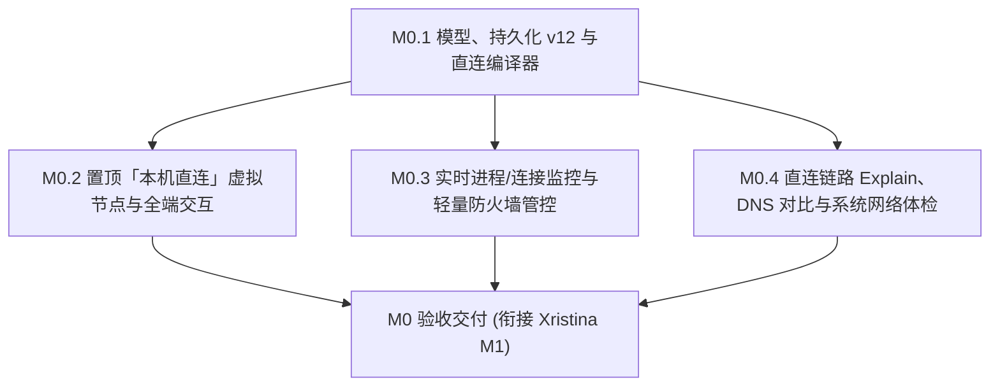

# M0 技术实施方案：DIRECT AS FIRST CLASS（Project Xristina 前置里程碑）

> [!IMPORTANT]
> **里程碑定位（Pre-Xristina M0）**：在启动自研 Rust 统一数据面内核 **Xristina**（参见 [MILESTONE.M1.PROJECT-XRISTINA.md](MILESTONE.M1.PROJECT-XRISTINA.md) 与 M2 方案 [MILESTONE.M2.XRISTINA-LINK.md](MILESTONE.M2.XRISTINA-LINK.md)）之前，先基于现有 `sing-box`（切换为默认内核）与 `AppModel` 完成上层**产品形态转型**与**核心契约解耦**。完成后，Xrose 在零订阅、零代理节点场景下即可作为全天候的**实时流量监控器、连接捕获与轻量应用防火墙、以及网络诊断工具箱**开箱运行，同时为 `CoreKind::Xristina` 锁定稳定的意图、遥测与诊断接口。


> **实现说明**：下文的数据库版本号记录 M0 开发过程。发布基线已统一为 v1，现行建库与升级行为见[存储架构](ARCHITECTURE.md#11-持久化与安全边界)。新配置使用系统 DNS，广告拦截规则由用户按需启用，因此首次直连启动无需预下载规则集。

---

## 一、 战略承接：M0 如何为 Xristina 铺平道路

若直接在现有「强依赖代理节点与外部 Clash JSON 结构」的上层代码上开发 Xristina M1，将不得不双线重构底层网络栈与全部 UI/Service 状态机。设置 **M0 前置里程碑** 可实现「产品价值提前交付」与「引擎接口提前定型」：


### M0 为 Xristina 提前固化的四项架构契约

| 契约层 | M0 落地内容（当前由 `sing-box` / OS 驱动） | Xristina M1+ 无缝替换方式 |
| :--- | :--- | :--- |
| **1. 意图模型契约** | [`AppModel`](../crates/xrose-core/src/model/mod.rs#L129-L150) 引入与分流模板正交的 `WorkMode::{Direct, Proxy}`，保留 `Block` 防火墙规则、直连 DNS 与组网拓扑 | `xristina-engine` RCU 编译器直接读取同一 `AppModel`，`Direct <-> Proxy` 由进程重启升级为 `ArcSwap` 微秒级热切换 |
| **2. 流遥测与管控契约** | 抽象内核无关的实时流速率追踪器 `FlowRateTracker`、进程实时聚合视图 `ProcessLiveTraffic` 与连接断开接口 | 数据源从 1.2s Clash API 轮询切换为 `xristina-guard` 共享内存环形缓冲区事件流，UI 层（`connections.rs`）零改动 |
| **3. 链路 Explain 契约** | [`trace.rs`](../crates/xrose-core/src/trace.rs) 支持无代理直连测试、拦截规则命中定位与多上游 DNS 并发对比 | 底层替换为 Xristina 引擎内原生 `Packet/Flow Explain` 管线，复用同一套多阶段 UI 渲染模型 |
| **4. 系统网络体检契约** | 新增免内核启动的网卡/默认路由、系统 DNS、监听端口归属与 NAT/连通性检查模块 | 直接演进为 Xristina 的物理上联网卡绑定预检、PMTUD 与 STUN 诊断底座 |

---

## 二、 分阶段技术拆解与实施细则

整个 M0 拆分为四个可独立编译、独立测试、递增交付的子阶段（`M0.1` → `M0.4`）：



---

### Phase M0.1：核心模型、默认 `sing-box`、数据库迁移与直连编译器

#### 1. 默认内核统一与 `WorkMode` 建模
* **涉及文件**：
  * [mod.rs](../crates/xrose-core/src/model/mod.rs#L30-L36)
  * [settings.rs](../crates/xrose-core/src/settings.rs#L187-L191)
* **具体变更**：
  1. 将 [`CoreKind`](../crates/xrose-core/src/model/mod.rs#L32-L36) 的 `#[default]` 从 `Xray` 调整为 `SingBox`，与 [`Settings::default()`](../crates/xrose-core/src/settings.rs#L190) 完全对齐，确保新配置默认拥有连接列表、进程查找（`find_process`）、Fake-IP 与三维度流量统计能力。
  2. 在 `xrose_core::model` 中定义一等工作模式枚举与虚拟节点保留常量（不混入 `model.nodes` 数组，防止污染订阅更新、节点计数、分享导出与组网同步）：
     ```rust
     pub const DIRECT_VIRTUAL_NODE_ID: &str = "__xrose_direct__";

     #[derive(Debug, Clone, Copy, PartialEq, Eq, Serialize, Deserialize, Default)]
     #[serde(rename_all = "snake_case")]
     pub enum WorkMode {
         #[default]
         Direct,
         Proxy,
     }
     ```
  3. 在 [`AppModel`](../crates/xrose-core/src/model/mod.rs#L129-L150) 新增 `#[serde(default)] pub work_mode: WorkMode;`：
     * `AppModel::default()` 默认 `work_mode: WorkMode::Direct`（新安装开箱即可点「启动」进入直连监控）。
     * 切换 `work_mode` **绝不覆盖** `routing.preset`、`routing.rules`、`default_group` 或各出站组的 `selected` 节点，确保 `Direct <-> Proxy` 往返无损。

#### 2. 数据库平滑迁移（`SCHEMA_VERSION: 11 -> 12`）
* **涉及文件**：[storage/mod.rs](../crates/xrose-core/src/storage/mod.rs#L22)
* **迁移逻辑**：
  * 提升 `SCHEMA_VERSION` 至 `12`（自动触发迁移前数据库备份 `backup_before_migration`）。
  * 遍历 `profiles` 表解密 JSON：若记录尚无 `work_mode` 字段：
    * 当 `model["nodes"]` 为非空数组时，写入 `"work_mode": "proxy"`（**保障升级老用户保持原有代理行为，零破坏性变更**）；
    * 当 `model["nodes"]` 为空时，写入 `"work_mode": "direct"`。
  * 保留所有未知字段并重新通过 `SecretBox` 加密校验后落盘。

#### 3. 编译器直连守护语义与防断网保护
* **涉及文件**：
  * [singbox.rs](../crates/xrose-core/src/adapters/singbox.rs)
  * [xray.rs](../crates/xrose-core/src/adapters/xray.rs)
  * [adapters/mod.rs](../crates/xrose-core/src/adapters/mod.rs)
  * [pac.rs](../crates/xrose-core/src/system/pac.rs)
  * [node_switch.rs](../crates/xrose-core/src/service/node_switch.rs)
* **编译规则矩阵（当 `model.work_mode == WorkMode::Direct` 时）**：
  1. **出站与前置代理**：不编译 `model.nodes` 中的远端代理节点与 `front_proxy`，不触发 [`singbox.rs:294`](../crates/xrose-core/src/adapters/singbox.rs#L294-L302) 与 [`xray.rs:173`](../crates/xrose-core/src/adapters/xray.rs#L173-L178) 的空节点报错；生成 `direct`（及 Xray 的 `block` / `dns-out`）和已激活的异地组网接口出站（`xrose-mesh-*`）。
  2. **路由与防火墙拦截保留**：
     * 启用规则（含自定义规则分组与未分组规则）中 `RouteActionKind::Block` **原样编译为 `action: reject`（sing-box）/ `blackhole`（Xray）**——使直连模式天然具备进程联网阻断与去广告规则集拦截能力；
     * `RouteActionKind::Proxy` 与 `final_action = Proxy` 在编译期统一映射为 `"direct"`；若仅输出 `direct` 且无意义冗余匹配项可保持规则可见性以便 Clash API `/connections` 仍能展示命中的分流规则供诊断参考（或标记 `direct`）。
  3. **DNS 防断网剥离（关键）**：
     * 在 [`build_dns`](../crates/xrose-core/src/adapters/singbox.rs#L1153) 与 Xray DNS 构建中：若某个 `DnsServer` 显式配置了指向代理组的 `detour`（例如预设中走代理的 `1.1.1.1` DoH），在 `Direct` 模式下**跳过该代理上游服务器及其分域规则**，并在 `CompiledConfig::warnings` 中提示：`“直连模式下已跳过依赖代理出站的 DNS 服务器「remote」，改用本地/直连 DNS”`。
     * 若跳过后无剩余可用上游服务器（例如用户选了「全加密 DNS」预设且所有服务器均需代理），自动回退至 `local` 系统解析器作为 `final`，防止国内网络环境下裸连被封锁 DoH 导致整机断网。
     * 直连可达的自定义加密 DNS（如 `223.5.5.5` / `1.12.12.12` DoH/DoT）、自定义 `Hosts`、`Fake-IP` 以及组网 `MagicDNS` 全部正常生效。
  4. **按需规则集预下载（免首次启动卡死）**：
     * 更新 [`required_rule_sets(model)`](../crates/xrose-core/src/adapters/mod.rs#L62-L95)：在 `WorkMode::Direct` 下，**仅收集 `Block` 动作规则与有效直连 DNS 服务器所引用的规则集**（本地缓存已存在的 `.srs` 可照常挂载，缺失的纯 `Proxy` 规则集如 `geosite-gfw` 不再阻塞 `start_core` 预下载），彻底解决无代理环境下首次启动拉取 GitHub 规则集超时失败的问题。
  5. **系统代理与后台测速协同**：
     * `Direct` 模式下若用户未开 TUN 而开启了「系统代理」，强制使用指向本地 Mixed/HTTP 入站的系统代理而非全返回 `DIRECT` 的 PAC，确保遵循系统代理的应用流量经过内核完成统计、嗅探与 `Block` 拦截。
     * [`node_switch.rs`](../crates/xrose-core/src/service/node_switch.rs) 在已应用模型为 `WorkMode::Direct` 时静默跳过周期探测。

> [!NOTE]
> **Xray 降级策略**：当用户手动将内核切为 `Xray` 并运行 `Direct` 模式时，遵循 [AGENTS.md](../AGENTS.md#L24) 约束 2，允许正常编译启动（提供总上下行吞吐统计、`Block` 拦截与组网路由），并在 `warnings` 中提示：`“Xray 不支持连接列表及进程/域名流量分类；如需完整网络监控请切换至 sing-box”`。

---

### Phase M0.2：置顶不可删除「本机直连」虚拟节点与全端交互闭环

严格遵循 [DESIGN.md](DESIGN.md) 的视觉规范（特别注意 §3.1 与 §5.5：**绝不使用绿色表达“直连”分类**，`直连` 徽标统一使用中性灰 `p.muted_fg` + `p.panel_alt`，选中态统一使用 `--accent-soft` 底色 + `3px` 蓝绿 accent 左条 + `20×20` Radio 圆点）。

#### 1. `AppService` 模式与选择接口
* **涉及文件**：[service.rs](../crates/xrose-core/src/service.rs)
* **新增/调整方法**：
  * `pub fn select_direct_mode(&self)`：将 `model.work_mode` 设为 `WorkMode::Direct` 并持久化；若内核正在运行，自动调用 `apply_config()` 平滑切换并弹出简洁提示 `“已切换至本机直连”`。
  * `pub fn select_proxy_mode(&self)`：当默认出站组无可用节点时提示先添加或启用节点；否则将 `model.work_mode` 设为 `WorkMode::Proxy`（主要用于默认组为自动测速/故障切换组时从直连切回代理）。
  * 增强现有 [`select_node(group_id, node_id)`](../crates/xrose-core/src/service.rs#L1340) 与 [`select_mesh_exit`](../crates/xrose-core/src/service/mesh_exit.rs#L15)：当当前处于 `WorkMode::Direct` 且用户点选了任意真实代理节点或组网出口时，在同一事务内将 `work_mode` 切回 `WorkMode::Proxy`、更新选中节点并应用配置。

#### 2. 节点页置顶虚拟行与首次引导瘦身
* **涉及文件**：
  * 新增 `crates/xrose-app/src/ui/nodes/direct_entry.rs`（与现有 [`mesh_exits.rs`](../crates/xrose-app/src/ui/nodes/mesh_exits.rs) 结构对称）
  * [ui/nodes.rs](../crates/xrose-app/src/ui/nodes.rs)
* **设计细节**：
  * **置顶固定渲染**：位于折线图下方、所有节点与订阅分组最顶部；不参与「按延迟排序」、不响应拖拽排序、不进入批量多选删除、不受节点搜索过滤隐藏（或仅在搜索词不匹配“直连/direct”且非选中时可选折叠，建议常驻置顶保持心智稳定）。
  * **行内元素（高 `NODE_ROW_HEIGHT = 64px`）**：
    * 左侧预留与拖拽手柄等宽的 `14px` 对齐占位 + `20×20` Radio 单选圆环（`model.work_mode == WorkMode::Direct` 时选中，附 `3px` accent 左边条与 `p.accent` 浅底）；
    * 主标题：`本机直连` / `Direct` + 中性灰徽标 `直连监控` / `Direct monitor`；
    * 副标题：动态展示当前监控范围——若已开启 TUN 显示 `全局进程监控（TUN） · 拦截规则与 DNS 生效`；未开启 TUN 显示 `本地代理入站 · 开启 TUN 可捕获全部本机进程`；
    * 右侧无删除/编辑/开关控件；若默认出站组配置了自动切换且当前处于直连模式，可在右侧提供紧凑次级按钮 `恢复自动代理` 以便一键回到自动组。
  * **空节点引导卡升级（[`nodes.rs:85`](../crates/xrose-app/src/ui/nodes.rs#L85-L180)）**：
    * 文案从“三步开始：添加订阅 → 下载 Core → 启动”升级为双路径引导：说明无需订阅即可直接下载 `sing-box` 并点击右上角「启动」使用实时流量统计、连接捕获与网络诊断；同时保留「添加订阅」「下载 Core」「手动添加节点」操作按钮。

#### 3. 顶栏状态胶囊、下拉菜单、托盘面板与 CLI
* **涉及文件**：
  * [ui/mod.rs](../crates/xrose-app/src/ui/mod.rs#L761-L960)
  * [ui/menus.rs](../crates/xrose-app/src/ui/menus.rs#L366-L417)
  * [tray/dashboard.rs](../crates/xrose-app/src/tray/dashboard.rs) & [tray/popup.rs](../crates/xrose-app/src/tray/popup.rs)
  * [crates/xrose-cli/src/main.rs](../crates/xrose-cli/src/main.rs)
* **联动行为**：
  * **顶栏胶囊**：`WorkMode::Direct` 时胶囊名称显示 `本机直连` / `Direct`，隐藏右侧节点延迟字段，Tooltip 展示运行状态、代理监听地址与 TUN 网卡名。
  * **`MenuTarget::NodeSelector`**：首项固定为 `本机直连`（带勾选态），下方分隔线后列出代理出站组节点（若为自动选择出站组且存在可用成员，提供 `自动选择（<组名>）` 项以支持切回代理模式）。
  * **托盘面板**：`Dashboard.nodes` 第 0 项固定注入 `DashboardNode { id: DIRECT_VIRTUAL_NODE_ID, label: "本机直连", delay_ms: None, active: is_direct }`；直连模式下托盘「路由模式」下拉框禁用并显示灰态说明，避免误解分流模板仍在走代理。
  * **`xrose-cli`**：新增 `xrose-cli mode [direct|proxy]` 子命令，并验证空配置下 `xrose-cli compile` 与 `xrose-cli check` 直接通过。

---

### Phase M0.3：实时流量监控、连接捕获增强与轻量应用防火墙

此阶段将「连接」页打造成网络监控核心面板，同时按 Xristina `xristina-guard` 的目标数据结构抽象流观测层。

#### 1. 内核无关的实时速率追踪与进程聚合（`xrose-core::flow`）
* **涉及文件**：
  * 新增 `crates/xrose-core/src/flow.rs`（并在 `lib.rs` 导出）
  * [runtime/clash.rs](../crates/xrose-core/src/runtime/clash.rs)
  * [service.rs](../crates/xrose-core/src/service.rs)
  * [traffic_statistics.rs](../crates/xrose-core/src/traffic_statistics.rs)
* **核心数据结构（对齐未来 Xristina 共享内存遥测）**：
  ```rust
  #[derive(Debug, Clone, Default, Serialize, Deserialize)]
  pub struct ConnectionMetrics {
      pub up_speed: u64,
      pub down_speed: u64,
      pub duration_secs: u64,
  }

  #[derive(Debug, Clone, Default, Serialize, Deserialize)]
  pub struct ProcessLiveTraffic {
      pub process_name: String,
      pub active_connections: usize,
      pub up_speed: u64,
      pub down_speed: u64,
      pub up_total: u64,
      pub down_total: u64,
  }
  ```
* **计算与管控逻辑**：
  1. `FlowRateTracker` 在 `AppService` 现有的后台 ~1.2s 监控协程中，对每次采样的活跃连接按 `(id, start)` 与上一拍字节数及 `Instant` 时间差计算瞬时 `up_speed` / `down_speed`，同时聚合生成按实时总速率降序排列的 `Vec<ProcessLiveTraffic>`，写入 `RuntimeView`（UI `render/tick` 仅做切片读取，零计算开销）。
  2. 在 [`ClashClient`](../crates/xrose-core/src/runtime/clash.rs) 中补齐：
     * `pub async fn close_connection(&self, id: &str) -> Result<()>`（`DELETE /connections/{id}`）
     * `pub async fn close_all_connections(&self) -> Result<()>`（`DELETE /connections`）
     并在 `AppService` 暴露 `close_connection(id)` 与 `close_all_connections()`。
  3. 历史流量统计优化：在 [`traffic_statistics.rs`](../crates/xrose-core/src/traffic_statistics.rs) 中确保 `TrafficEntityKind::Direct` 在 UI 图表与表格中清晰显示为「本机直连 / Direct」；当处于 `Direct` 模式首次展开统计卡片时，若用户尚未手动切过维度，可优先展示更具可读性的 **「进程」** 维度。

#### 2. 「连接」页监控工作台升级
* **涉及文件**：
  * [ui/connections.rs](../crates/xrose-app/src/ui/connections.rs)
  * [ui/menus.rs](../crates/xrose-app/src/ui/menus.rs)
* **界面与交互升级（严格复用 `ChoiceGroup` Segmented、列表卡片与确认弹窗）**：
  1. **新增「连接 / 进程」实时视角切换**：
     * 在 `实时 / 录制` Segmented 旁提供 `连接明细 / 活跃进程` 视图切换（录制模式下锁定连接明细）：
       * **活跃进程视角**：列出当前正在联网的本地程序名、活跃连接数、实时上下行速率（等宽字体，`--data-down` / `--data-up`）、当前活跃连接累计上下行，支持点击某个进程直接带入过滤条件查看其名下全部连接，或一键对该进程创建 `阻止联网 (Block)` 规则。
  2. **连接排序器**：支持按 `最新建立`、`实时速率`、`累计流量` 排序，秒抓占满带宽的异常连接。
  3. **单连接详情与一键管控**：
     * 每条活动连接行展示**实时上下行速率**（非零时高亮显示）+ 累计上下行 + 存活时长；
     * 行尾除现有的「连接透视」按钮外，提供「断开连接」图标按钮（默认中性灰，hover 变 `danger`，带 tooltip 与无障碍标签）及右键/更多菜单中的快捷规则动作（**在直连模式下将「阻止此域名 / 阻止此进程 / 阻止此 IP」作为高频动作突出**，实现轻量桌面防火墙闭环）；
     * 连接页头 `⋯` 菜单中的「关闭全部连接」接入实色确认对话框（修复并严格遵循 [DESIGN.md §5.7](DESIGN.md#L368)）。
  4. **监控完整度引导提示**：
     * 当 `running && model.work_mode == WorkMode::Direct && !settings.tun_enabled` 时，在过滤栏下方展示一行克制的信息条：`“当前仅捕获系统代理流量；开启 TUN 模式可监控本机全部进程连接”`，右侧附 `[开启 TUN]` 快捷按钮。

---

### Phase M0.4：网络诊断工具箱（直连 Explain、DNS 对比与免内核系统体检）

此阶段同时兑现 [ROADMAP.md](ROADMAP.md) 系统诊断待办，并为 Xristina §3.5 原生诊断定型 UI。

#### 1. 链路测试（`trace.rs`）直连与拦截可解释适配
* **涉及文件**：[trace.rs](../crates/xrose-core/src/trace.rs)、[ui/connections.rs](../crates/xrose-app/src/ui/connections.rs)
* **增强点**：
  * 当 `model.work_mode == WorkMode::Direct` 时：
    * 第 `04 路由 / 分流` 阶段准确评估是否命中 `Block` 拦截规则或异地组网网段——若命中 `Block` 规则，立即将该阶段标为阻断状态并给出**具体命中的规则名称与分组**（实现 Xristina 规划中的「拦截可解释回放」，方便排查误杀并一键修改规则）；
    * 第 `05 出站节点` 阶段明确显示 `本机直连`（或命中的 `EasyTier / Tailscale` 虚拟网卡接口），不再提示缺少代理出站。

#### 2. 多上游 DNS 解析对比探测（`xrose-core::dns::probe`）
* **涉及文件**：新增 `crates/xrose-core/src/dns/probe.rs`（或置于 `diagnostics` 子模块）与测试页卡片
* **功能设计**：
  * 输入任意域名（或直接复用链路测试输入框的主机名），并发向 3–4 组代表性解析器发起标准 DNS A / AAAA 查询（纯 Rust UDP / DoH 请求，超时 3s，不阻塞 UI）：
    1. **系统默认解析器**（OS Resolver）
    2. **配置中的直连公共 DNS**（如 `223.5.5.5`）
    3. **配置中的加密 DNS / 组网 MagicDNS**
    4. **当前运行内核 DNS**（内核运行时经本地入站解析）
  * 表格展示各上游返回的 **IP 列表、归属地标签、响应耗时（ms）**，并对出现保留地址/`0.0.0.0`/跨网段异常差异的结果标注提示，专治不挂代理时的内网域名解析失败、ISP 劫持与 Fake-IP 残留排查。

#### 3. 免内核启动的「系统网络与环境诊断」面板
* **涉及文件**：
  * 新增 `crates/xrose-core/src/system/net_diag.rs`
  * 扩展 [system/port_owner.rs](../crates/xrose-core/src/system/port_owner.rs) 与 [system/tun.rs](../crates/xrose-core/src/system/tun.rs)
  * 测试页 UI 与 `xrose-cli doctor`
* **检查项清单（Core 未启动亦可随时点击「刷新诊断」与「复制报告」）**：
  1. **网络接口与默认路由**：枚举活跃物理网卡与虚拟网卡（TUN / EasyTier / Tailscale）、IPv4/IPv6 地址、MTU 与系统默认网关接口；
  2. **系统 DNS 与系统代理快照**：当前 OS 生效的 DNS 服务器列表、系统 HTTP/SOCKS/PAC 代理状态及是否指向本机 Xrose；
  3. **关键端口监听与进程归属**：检查 Mixed 端口、LAN 端口、Clash API 端口、PAC 端口及组网转发端口的占用情况与所属进程名/PID；
  4. **提权助手管理合一**（完成 [ROADMAP.md](ROADMAP.md) 待办）：将提权助手的运行/版本状态及「安装 / 启动 / 更新 / 卸载」快捷动作整合进诊断检查列表；
  5. **脱敏复制**：一键生成结构化诊断文本，开启隐私模式时自动遮罩本机局域网/公网 IP、主机名与用户名。

---

## 三、 关键改动文件清单汇总

| Crate / 模块 | 关键文件 | 主要职责 |
| :--- | :--- | :--- |
| **`xrose-core` 模型与存储** | `model/mod.rs`, `settings.rs`, `storage/mod.rs` | `CoreKind` 默认切为 `SingBox`；新增 `WorkMode` 与 `DIRECT_VIRTUAL_NODE_ID`；SQLite `SCHEMA_VERSION` 升至 `12` 平滑迁移新老配置 |
| **`xrose-core` 编译器** | `adapters/mod.rs`, `adapters/singbox.rs`, `adapters/xray.rs` | 直连模式零节点编译、`Block` 规则保留、代理 `detour` DNS 防断网剥离、按需规则集筛选 |
| **`xrose-core` 遥测与服务** | `flow.rs` *(新增)*, `runtime/clash.rs`, `service.rs`, `service/node_switch.rs`, `traffic_statistics.rs` | 连接/进程实时速率追踪器、Clash 连接断开 API、直连/代理模式切换事务、PAC 与自动切换适配 |
| **`xrose-core` 网络诊断** | `trace.rs`, `dns/probe.rs` *(新增)*, `system/net_diag.rs` *(新增)*, `system/port_owner.rs`, `system/tun.rs` | 直连链路测试与 `Block` 命中解释、多上游 DNS 对比探测、免内核网卡/路由/DNS/端口/助手一体化体检 |
| **`xrose-app` 桌面端 UI** | `ui/nodes.rs`, `ui/nodes/direct_entry.rs` *(新增)*, `ui/mod.rs`, `ui/menus.rs`, `ui/connections.rs`, `tray/dashboard.rs`, `tray/popup.rs` | 置顶不可删除「本机直连」虚拟节点、顶栏胶囊与托盘联动、连接页实时速率/活跃进程视图/一键断开与防火墙快捷拦截、测试页系统诊断卡片 |
| **`xrose-cli` 与文档** | `crates/xrose-cli/src/main.rs`, `README.md`, `docs/ARCHITECTURE.md`, `docs/DESIGN.md`, `docs/ROADMAP.md` | CLI `mode` 与增强版 `doctor` 命令；同步能力矩阵、UI 规范与路线图状态 |

---

## 四、 验证与交付标准

> [!TIP]
> 所有自动化测试严格遵守 [AGENTS.md](../AGENTS.md#L39) 铁律：**不依赖真实网络、运行中内核、root 权限或显示器**，测试夹具一律使用 RFC 5737 保留地址（如 `192.0.2.x`、`example.org`）等虚构数据；CLI 验证全部在隔离目录 `XROSE_HOME=/tmp/xrose-m0-demo` 下执行。

1. **核心层离线单元测试（`cargo test -p xrose-core`）**：
   * **模式与迁移测试**：全新空库默认 `WorkMode::Direct` + `CoreKind::SingBox`；v9、v10、v11 旧库升级至 v12 时，含节点配置自动迁移为 `Proxy`、空节点配置自动迁移为 `Direct`，加密完整性与未知字段保留无损。
   * **直连编译边界测试**：零节点配置在 `SingBoxAdapter` 与 `XrayAdapter` 下编译成功；`Block` 规则正确生成 `reject`/`blackhole`；`Proxy` 规则归入 `direct`；带 `detour` 的加密 DNS 被剥离且全部被剥离时安全回退 `local` 并产出中文警告；`required_rule_sets` 在直连模式下不包含仅被 `Proxy` 规则引用的 `geosite-gfw`；组网共存路由与 MagicDNS 在直连模式下原样保留。
   * **实时流追踪测试**：`FlowRateTracker` 在连续采样、短连接出现与消失、字节计数回退（内核重启）场景下的速率与进程聚合计算准确性。
   * **诊断与脱敏测试**：`trace` 直连路由与 `Block` 规则命中归因；`net_diag` 输出在开启/关闭 `privacy_mode` 下的地址遮罩完整性。
2. **UI 与工作区构建检查（`cargo test -p xrose-app` & `cargo build --workspace`）**：
   * 全工作区零编译警告（`cargo build --workspace`）；
   * 对照 [DESIGN.md §12](DESIGN.md#L552-L565) 完成浅色/暗色、中英文、`本机直连` 中性灰徽标与蓝绿选中态、键盘焦点与批量断开确认弹窗自检。
3. **端到端无界面验收（`xrose-cli`）**：
   * 在全新空目录 `XROSE_HOME=/tmp/xrose-m0-demo` 下，不导入任何节点直接执行 `xrose-cli compile --core sing-box` 与 `xrose-cli doctor`（以及本机若已安装 `sing-box` 时执行 `xrose-cli check`）全部一次通过。
