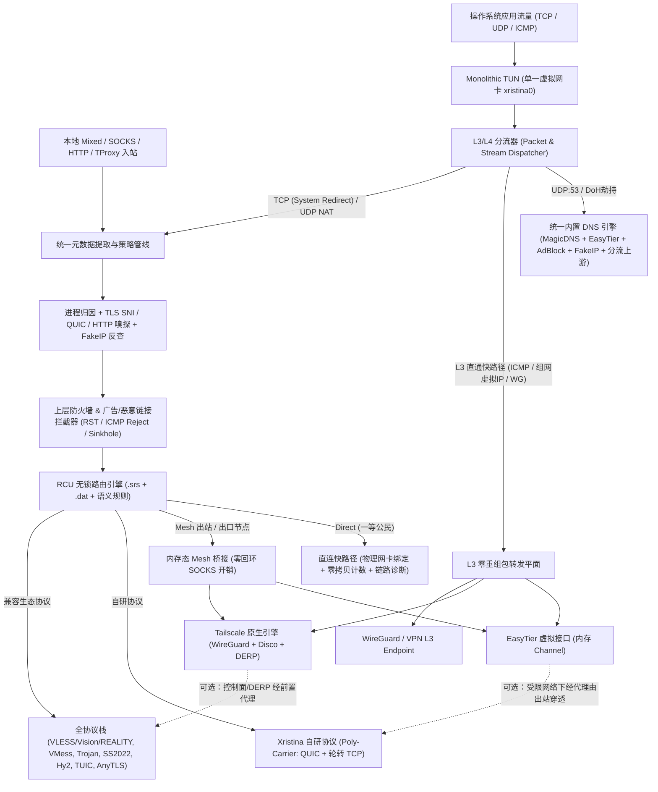
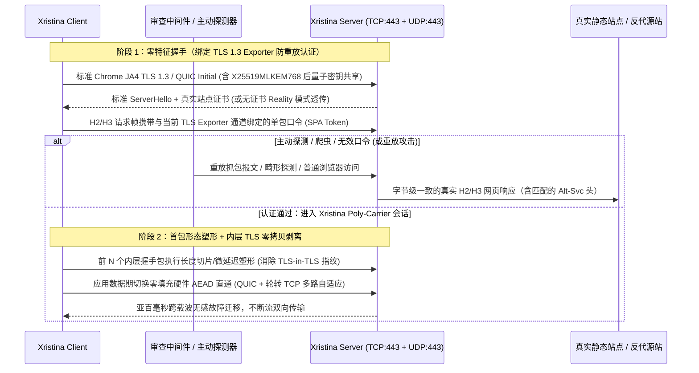
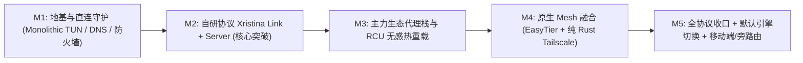

# M1 架构蓝图与地基方案：Project Xristina（Monolithic TUN 与统一网络引擎）

> [!IMPORTANT]
> **里程碑定位（Project Xristina M1）**：前置里程碑 M0（直连一等公民，参见 [MILESTONE.M0.DIRECT-AS-FIRST-CLASS.md](MILESTONE.M0.DIRECT-AS-FIRST-CLASS.md)）完成后，M1 作为自研 Rust 统一数据面内核 **Xristina** 的**地基里程碑**启动——实现单一虚拟网卡（Monolithic TUN `xristina0`）、内置统一 DNS 总线、零拷贝 L3 交换、应用防火墙与原生直连守护，为后续自研协议 M2（参见 [MILESTONE.M2.XRISTINA-LINK.md](MILESTONE.M2.XRISTINA-LINK.md)）与生态兼容 M3 提供坚不可摧的数据面底座。
> 
> **核心愿景**：将 Xross 从「跨平台 Xray / sing-box 编排客户端 + 异地组网胶水层」，升级为拥有自研 Rust 统一数据面内核 **Xristina** 的**全天候个人可编程网络层（Personal Programmable Network Engine）**——在无订阅、无代理节点的纯直连场景下依然提供开箱即用的流量观测、广告与追踪拦截、应用防火墙与链路诊断；在接入组网与跨境代理时，以单一虚拟网卡（Monolithic TUN）无损融合直连、Mesh 与全协议代理。

---

## 一、为什么现在需要 Xristina？（直击当前架构的五大结构性天花板）

当前 [`AppModel`](../crates/xross-core/src/model/mod.rs#L129-L150) 已经漂亮地将「用户意图」与底层配置解耦，但在运行期（参见 [ARCHITECTURE.md](ARCHITECTURE.md) 与 [MESH.md](MESH.md)），外部多内核架构正承受高昂的「多进程、多网卡、零热重载税」：

| 痛点维度 | Xross 现状 | Xristina 带来的质变 |
| :--- | :--- | :--- |
| **多网卡分裂（3-TUN Split-Brain）** | 代理 TUN + EasyTier `--mesh-worker` TUN + Tailscale 专用 `sing-box 1.14.4` TUN 三套虚拟网卡并存；靠 [`CoexistencePlan`](../crates/xross-core/src/mesh/coexist.rs#L18-L22) 做 CIDR 差集排除、回环鉴权 SOCKS 桥接，以及 NRPT / `/etc/resolver` / `127.0.0.153:53` 等系统级 DNS 补丁。 | **单一 Monolithic TUN (`xristina0`)**：仅注册一张虚拟网卡、一套系统路由与单一内置 DNS 引擎，Mesh 与代理之间在内存内零拷贝直通，彻底告别 Teredo 抖动、`strict_route` 冲突与回环 SOCKS 损耗。 |
| **无热重载与连接中断** | 修改规则、出站组自动切换、组网状态变更均需「重编译 JSON → 外部 `check` → 重启进程」，导致存量 TCP / SSH / 下载连接全部断开；节点测速还需拉起短期临时内核进程。 | **基于 RCU (`ArcSwap`) 的微秒级原子热更新**：路由表、防火墙策略、DNS、节点切换、Mesh 拓扑变更毫秒生效，不断流；节点探测直接在引擎内复用拨号器完成。 |
| **双核能力割裂与观测盲区** | [`Capabilities`](../crates/xross-core/src/model/mod.rs#L105-L124) 中 Xray 无连接列表、无进程/域名归因、无 Fake-IP、无 Hysteria2/TUIC/AnyTLS；sing-box 每 1.2 秒轮询 Clash API 导致短连接落入「未归因」。 | **单一超集能力矩阵 + 事件流遥测**：所有协议一等支持；每条连接从 SYN / 首包即产生生命周期事件，经共享内存环形缓冲区推送，短连接 100% 精确归因。 |
| **「不翻墙即闲置」与上手门槛** | 首次启动需先下载外部 Core 并导入订阅才能产生价值（见 [ROADMAP.md](../ROADMAP.md#L23)）。 | **内置内核零下载启动 + 直连守护一等公民**：安装即用，日常办公/国内网络下作为低开销防火墙、去广告网关与网络抓包诊断仪常驻运行。 |
| **移动端与内存上限瓶颈** | Go 运行时（Xray / sing-box / Tailscale）GC 内存占用高，未来拓展 iOS `NEPacketTunnelProvider`（系统硬限制 50 MB RAM）极易触发 OOM Jetsam。 | **零 GC 纯 Rust 引擎**：配合内存映射规则集，核心运行内存可压控在 **15–25 MB**，天然为 Xross 移动端（iOS / Android）及路由器端（OpenWrt）铺平道路。 |

---

## 二、架构全景：Monolithic TUN 与统一数据面

Monolithic TUN 是串联其余四大能力的脊梁。核心思想是：**对操作系统只暴露一张三层虚拟网卡，而在 Xristina 内部实现一台兼具 L3 包交换与 L4 流代理的「软件定义路由器（VRF / Virtual Switch）」**。

### Monolithic TUN 的四项关键工程设计

1. **L3 包交换与 L4 流重组双平面（解决组网 ICMP 与高吞吐矛盾）**
   - **L3 零重组快路径**：目的地址命中 Tailscale（`100.64.0.0/10`、`fd7a:115c:a1e0::/48`）、EasyTier 虚拟网段或远端子网、以及纯三层 WireGuard Endpoint 时，IP 包在防火墙策略放行后**无需经过用户态 TCP 协议栈重组**，直接投递进对应隧道队列。这不仅消除了双栈拷贝，还让系统原生 `ping` / `traceroute` 对 Tailscale 与 EasyTier 设备**天然可用**（彻底解决当前 [MESH.md](MESH.md#L168) 中用户态组网无法直接响应系统 ICMP 的限制）。
   - **L4 Hybrid (`Mixed`) 栈**：对于需走流代理（VLESS / 自研协议 / 直连嗅探）的 TCP 连接，默认采用 **System TCP Redirector**（改写源目地址投递至内核态回环监听器，直接复用 OS 内核级 BBR/CUBIC 拥塞控制与硬件 TSO/GSO），保留轻量 `smoltcp` 作为沙盒或特殊平台兜底；UDP 采用无锁会话 NAT 表。
2. **平台级零拷贝与批量 I/O 加速**
   - **Linux**：启用 `/dev/net/tun` 的 `IFF_MULTI_QUEUE` 与 **`IFF_VNET_HDR`（用户态 GSO/GRO 卸载）**——像现代 WireGuard-go / Tailscale 一样一次读写 64KB 超大聚合帧，单核吞吐可轻松突破 10 Gbps。
   - **Windows**：直接映射 `Wintun` 共享内存 Ring Buffer 批量收发，配合 IOCP 异步套接字与物理上联网卡强绑定（`IP_UNICAST_IF` / `IPV6_UNICAST_IF` 防路由回环）。
   - **macOS**：`utun` 配合 `recvmmsg` / `sendmmsg` 批量系统调用与 `IP_BOUND_IF`。
3. **内置统一 DNS 总线（终结系统级 DNS 污染与冲突）**
   - 取消外部多监听端口（如 `127.0.0.153:53`）和易残留的平台特化规则，所有 DNS 请求统一进入 Xristina DNS Pipeline：
     `Hosts / AdBlock Sinkhole → Tailscale MagicDNS (*.ts.net) → EasyTier 对端域名 → 自定义规则上游 (DoH/DoT/DoQ/H3/UDP) → Fake-IP 双向映射池`。
   - Fake-IP 表与连接追踪表同处一个进程内存空间，100% 消除「拿到了目标 IP 却反查不到原始域名」的归因断层。
4. **任意拓扑正交组合（Mesh × Proxy 自由编排）**
   - 因为直连、Mesh、代理全部统一实现内部 `OutboundConnector` / `PacketEndpoint` trait，Xristina 天然支持此前极难实现的组合：
     - **链式落地**：`本机 → 自研抗封锁节点 (海外中转) → Tailscale/EasyTier 远端家庭节点 (纯净住宅 IP 落地)`；
     - **反向穿透**：在严格校园网/企业网 UDP 被封死且 P2P 失败时，让 EasyTier / Tailscale 的底层传输连接直接 detour 走 Xristina 的抗探测代理通道建立组网！

---

## 三、直连模式作为一等公民：「全天候本机网络守护层」

将直连模式（`Direct Guardian Mode`）提升为一等公民，意味着即使 [`AppModel.nodes`](../crates/xross-core/src/model/mod.rs#L133) 为空，用户点击「启动」依然能运行一个超低损耗、高价值的本机安全与观测内核：

### 1. 零感知损耗的「直连快路径（Cut-Through Fast Path）」
- **连接首包裁决，后续内核态拼接**：连接建立时完成进程识别（PID → 可执行路径 / macOS Bundle ID / Windows 签名主体 / Linux cgroup）+ 无阻塞首包嗅探（TLS SNI / QUIC Initial SNI / HTTP Host）+ 防火墙与去广告策略匹配。
- 一旦裁决为 `Allow Direct`，数据流进入零解析字节直通模式（仅维护无锁 `AtomicU64` 速率与字节计数器）；对局域网 NAS 传输、Steam 满速下载、BT 流量可自动启用 Fast-Track，确保万兆内网不降速、低功耗笔记本不掉续航。

### 2. 全量实时与历史流量监控
- **彻底消灭短连接漏记**：基于事件驱动（`FlowOpened` / `FlowSampled` / `FlowClosed`）取代外部 API 轮询，连毫秒级的 DNS 查询或遥测短连接都能精确归入对应进程与主域名（复用并增强现有 [`traffic_statistics`](../crates/xross-core/src/traffic_statistics.rs) 的加密落库模型）。
- **实时多维透视**：支持按「应用/进程、主域名（PSL）、目标 ASN/地区、网络出口（物理网卡 / Mesh / 代理节点）」实时查看带宽波形与并发连接数。

### 3. 多层无证书广告与恶意链接拦截（Ad & Tracker Guard）
不依赖安装容易引发安全风险的根证书（不破坏 TLS 端到端加密），通过三层协同实现高质量净化：
1. **L1 — 极速 DNS Sinkhole**：使用双数组字典树（Double-Array Trie）+ Aho-Corasick 编译 AdGuard DNS Filter、Hosts、OISD、`geosite:category-ads-all` 等数十万条规则（内存占用 < 10 MB，匹配耗时亚微秒级）。
2. **L2 — SNI / QUIC ClientHello / 硬编码 IP 拦截**：针对国内部分客户端绕过系统 DNS（内置 HTTP-DNS、硬编码广告 IP 或后台偷跑 PCDN 上传）的行为，在 L4 嗅探阶段按 SNI、目标 CIDR、目标端口特征直接精准阻断；同时可对浏览器向已知公共 DoH 发起的绕过请求返回快速拒绝，迫使其回退至 Xristina 受控 DNS。
3. **L3 — 瞬时拒绝语义（Fast Reject）与可解释回放**：拦截动作绝不采用静默丢包（Drop 会导致网页或 App 卡死等待超时），而是立即返回 `DNS NXDOMAIN/0.0.0.0`、`TCP RST`、或 `ICMP Port Unreachable` / QUIC 拒绝帧；并在 Xross UI 提供**「最近拦截流」实时列表与「一键放行 5 分钟 / 加入白名单」**，彻底解决去广告误杀难排查的痛点。

### 4. 上层应用防火墙（Desktop Application Firewall）
- **出站细粒度管控**：为任意本地进程/目录配置网络作用域策略——`允许全部`、`仅限局域网 (LAN Only)`、`仅限异地组网 (Mesh Only)`、`禁止联网 (Offline Sandbox)`、`强制指定出站组`。
- **入站组网防火墙（Mesh Inbound Guard）**：当连接公司或共享的 EasyTier / Tailscale 网络时，无需修改远端控制台 ACL，即可在本机声明「组网对端仅允许访问本机 `22 / 8080` 端口，拒绝探测本机其他开发端口」。
- **可选防绕过加固（Strict Kill-Switch）**：针对恶意软件直接绑定物理网卡 IP 绕过 TUN 的情况，由提权助手按需下发轻量级系统规则（Windows WFP Filter / Linux nftables mark / macOS PF），只放行 `xristina` 自身标记的出站套接字。

### 5. 原生引擎级网络诊断（Engine-Native Diagnostics）
- **决策与实测合一的「连接全链路瀑布流（Packet/Flow Explain）」**：输入任意目标 URL/IP 或点击某条异常连接，直接在 Xristina 真实管线中输出毫秒级分步报告：
  `本地进程 → DNS 规则命中与上游耗时 → 解析结果/污染检测 → 防火墙/广告策略裁决 → 路由规则命中项 → 出口网卡/节点握手 RTT → TLS 版本与协商指纹 → HTTP 首字节耗时 (TTFB)`。
- **内置诊断工具箱**：集成原生 **MTR 路由追踪**、**路径 MTU 探测（PMTUD，专治 TUN 分片黑洞）**、**RFC 5780 STUN NAT 类型检测（一键诊断对称型 NAT 供 EasyTier/Tailscale 打洞参考）**、**Captive Portal 酒店/机场认证页自动识别与临时直连放行**、以及 **DNS / IPv6 / WebRTC 泄露自检**。

---

## 四、核心自研里程碑（M2 核心交付）：高性能、高隐蔽防探测协议（`Xristina Link` / `XLP`）

> [!NOTE]
> **里程碑调整说明**：在整体演进路线中，自研协议 `Xristina Link` 与配套轻量服务端 `xristina-server` 已从原规划的 M3 提前升级为 **M2 核心里程碑**（技术实施细则参见 [MILESTONE.M2.XRISTINA-LINK.md](MILESTONE.M2.XRISTINA-LINK.md)）。优先落地自研协议可在完成 M1 Monolithic TUN 地基后，立即跑通完全自主可控的端到端抗封锁通道，形成最强产品护城河；而繁重且无差异化的第三方兼容协议栈（sing-box / Xray 历史协议）则后置至 M3 逐步收口。

开源通用协议（VLESS、Trojan、Hysteria2 等）由于代码与状态机完全公开，始终处于与审查系统 DPI 特征库赛跑的被动位置。Xross 同时掌控客户端内核与自部署服务端（`xristina-server`），是设计下一代专有协议的绝佳前提。

### 审查对抗威胁模型与四大核心设计

1. **防主动探测：基于 `RFC 9266 TLS Exporter` 通道绑定的零侧信道认证**
   - 支持两种服务端部署形态：
     - **形态 A（推荐，自持域名源站模式）**：`xristina-server` 本身就是一台完整、合规的 HTTP/2（TCP 443）+ HTTP/3（UDP 443）Web 服务器，自动签发 ACME 证书并对齐 `Alt-Svc: h3=":443"` 响应头。客户端认证令牌与当前连接的 **TLS 1.3 Exporter 主密钥单向绑定**（附加时间戳与服务端布隆过滤器防重放）。任何第三方抓包重放或主动扫描都会看到 100% 真实的 HTTP/2 & HTTP/3 网站，不存在传统回落（Fallback）的跨进程转发时延差侧信道。
     - **形态 B（免域名偷跑模式 / Stealth Masquerade）**：类似 REALITY 思路，但客户端随机数采用 **Elligator2 不可区分曲线点编码**，默认对齐最新 Chrome 的 `X25519MLKEM768` 后量子混合密钥交换扩展，且强制校验证书目标站的同机房/低 RTT 约束以消除时延指纹。
2. **防被动流量分析：「早期握手塑形 + 数据期零开销直通」**
   - 现有协议要么完全不填充（暴露内层 TLS 握手包长序列 `TLS-in-TLS`），要么全程盲目填充浪费带宽。
   - **分级形态塑形（Staged Morphing）**：Xristina 仅对每条子流建立初期的 **前 6–10 个报文（内层 TLS 1.3 握手阶段）** 执行可配置的包长分片/合并（模拟正常 H2/H3 网页资源请求分布）与微秒级抖动注入；一旦检测到内层连接进入 `TLS Application Data (0x17)`，自动类似 Vision 机制剥离冗余封装，进入**零填充、硬件 AES-GCM / ChaCha20 直通模式**，大文件下载与 4K 视频零额外带宽税。
3. **最大性能杀手锏：`Poly-Carrier`（QUIC + 轮转 TCP 混合多载波传输）**
   - 传统方案中，Hysteria2/TUIC 强依赖 UDP（一旦遭遇运营商晚高峰 UDP QoS 限速或五元组掐断就断流），而 VLESS+TCP 在高丢包链路上受困于 TCP 队头阻塞（HoL Blocking）。
   - **`Poly-Carrier` 会话层**：单个逻辑会话下同时编排 **UDP QUIC 载波**（内置 BBRv3 与带 ECN/RTT 熔断保护的自适应激进拥塞控制 + 客户端主动 UDP 端口跳跃 Port Hopping）与 **XMUX 风格的短生命周期轮转 TCP/H2 载波**（单条 TCP 连接跑满定量流量或存活数分钟后平滑排空轮换，规避「单连接长时大流量」封锁模型）。
   - **亚百毫秒无感故障迁移**：当探测到 UDP 载波丢包激增或被黑洞阻断时，未确认帧在会话层**不断流平滑迁移**至热备 TCP 载波，上层用户连接（游戏、SSH、会议、下载）零感知！
4. **极简配套服务端 `xristina-server`**
   - 纯 Rust 静态编译单二进制（内存占用 < 15 MB），内置一键生成 `xristina://` 分享链接 / 订阅端点、多用户配额管理，甚至可在 Xross 桌面端提供「填入 SSH 凭据 → 30 秒自动在自有 VPS 部署并导入节点」的闭环体验。

---

## 五、全量兼容 sing-box / Xray 协议能力与工程分层

为了避免陷入「从零手写几十万行边缘老旧协议」的泥潭，建议按**架构统一、分层交付**推进所有 [`Protocol`](../crates/xross-core/src/model/node.rs#L10-L24) 与 [`Transport`](../crates/xross-core/src/model/node.rs#L190-L221) 能力：

### 1. 协议与传输矩阵规划
- **第一梯队（核心主力，纯 Rust 原生实现）**
  - **代理协议**：`Xristina Link`（自研）、`VLESS`（含 `xtls-rprx-vision`）、`Trojan`、`Shadowsocks`（AEAD 全系 + **SS-2022 BLAKE3** + UoT）、`VMess`（AEAD）、`Hysteria2`（含 Salamander 混淆与 Brutal 速率控制）、`TUIC v5`、`AnyTLS`、`SOCKS5`、`HTTP/HTTPS`。
  - **三层隧道**：`WireGuard`（基于纯 Rust `boringtun` / `gotatun` 深度定制，顺手支持多 Peer 与 **AmneziaWG** 垃圾包/报头混淆扩展！）。
  - **传输层与多路复用**：`TCP`、`WebSocket (0-RTT early data)`、`gRPC`、`HTTP/2`、`HTTPUpgrade`、**`XHTTP / SplitHTTP (XMUX)`**（补齐当前 Xray 生态极热门的抗封锁传输）、`QUIC`、`mKCP`；以及兼容 sing-box 的 `smux / yamux / h2mux (with padding)`。
- **第二梯队（传统企业级 VPN，模块化隔离）**
  - `OpenVPN` 与 `OpenConnect`（涉及大量历史加密套件与各厂商私有 XML/DTLS 握手方言）：抽象为独立的 `L3EndpointDriver` 插件接口，初期无需阻塞 Xristina 1.0 主线发布，按需以独立沙盒模块演进。

### 2. 攻克 Rust 生态最大的硬骨头：uTLS（TLS 指纹拟真）与 REALITY
- **问题本质**：标准 `rustls` 虽然安全高效，但其 ClientHello 扩展顺序、GREASE、密码套件列表与真实 Chrome/Safari（基于 BoringSSL / SecureTransport）存在明显差异，直连抗审查节点容易被 JA3/JA4 指纹识别。
- **推荐技术路径**：底层密码学与 TLS 握手层引入 **`boring` / `aws-lc-rs`（BoringSSL 同源 Rust 绑定，参考 Rust 生态 `rama` / `rquest` 路线）**，在其之上构建声明式的 **`ClientHello` 指纹模板引擎（Chrome / Firefox / Safari / iOS）** + HTTP/2 `SETTINGS` / `WINDOW_UPDATE` 帧指纹对齐，并在握手回调中原生插入 REALITY 的 SessionID HKDF 鉴权逻辑。这样在密码学实现上与真实 Chrome 同源，拟真度达到最高级别。

### 3. 双生态规则集零转换引擎
- 直接在 Rust 中原生解析 sing-box 的二进制 `.srs`（v1–v3）**以及** Xray 的 Protobuf `geoip.dat` / `geosite.dat`，统一编译进内存紧凑的基数树（IPv4/IPv6 Longest Prefix Match）与压缩自动机，无需在启动前做外部格式转换。

---

## 六、原生融合 EasyTier 与 Tailscale 组网能力

1. **EasyTier：从独立进程网卡转为内存态虚拟端口**
   - 保留现有 `easytier` Rust crate 优势，但不再让其向操作系统申请独立 Wintun / utun 网卡，而是实现自定义的 `VirtualTun` 通道直接挂载到 Xristina 的 L3 交换矩阵。
   - **新增能力**：支持多个 EasyTier 网络同时在线时的子网冲突 NAT 重映射（例如两个团队都用了默认 `10.126.126.0/24`，Xristina 可在本地无感将其一重映射为 `10.127.126.0/24` 访问！）。
2. **Tailscale：用纯 Rust `xristina-tailscale` 彻底取代固定的 `sing-box 1.14.4` 子进程**
   - Tailscale 客户端协议栈边界清晰（上游为 BSD-3-Clause）：
     - **控制面**：`ts2021`（Noise_IK over HTTP/2）对接官方 `controlplane.tailscale.com` 与自建 **Headscale**，处理设备注册、浏览器登录 URL 流式回调、NetMap 增量下发、出口/子网审批状态。
     - **数据面**：直接复用 Xristina 内置的用户态 WireGuard 引擎 + **Disco 加密打洞信令** + **STUN** + **DERP 中继客户端**。
     - **服务面**：内置 MagicDNS 处理器与 PeerAPI（保留现有 Xross 设备发现、SSH 标记与加密配置共享能力）。
   - **收益**：彻底移除下载外部 `sing-box 1.14.4` 组件的步骤，内存立减 60–100 MB，登录、路由白名单与代理分流全部在同一个引擎事务内闭环。

---

## 七、安全进程边界、模块拆分与分阶段演进路线

### 1. 推荐的进程与权限架构：「守护引擎进程 + 最小权限降级」
尽管 GUI（`xross-app`）与内核（`xristina`）同为 Rust，**强烈建议保持独立守护进程模型（而非直接塞进 GUI 进程）**：
- **生命周期解耦**：关闭 GUI 窗口、UI 升级或渲染异常不会导致整机断网或组网 SSH 掉线；且 `xristinad` 二进制可直接独立运行在无桌面的 Linux 服务器 / OpenWrt 旁路由上！
- **FD 传递最小权限模型（Unix `SCM_RIGHTS` / Windows 受限服务）**：
  - 在 Linux / macOS 上，极简的提权阶段仅负责打开 `/dev/net/tun` / `utun` 文件描述符、配置路由表与防火墙标记，随后将 **TUN FD 通过 Unix Domain Socket 传递给已降权（普通用户态沙盒）的 `xristina-engine`**——让复杂的 TLS 解析、代理协议和组网状态机全部运行在非 root 权限下！
  - GUI 与 `xristina-engine` 之间通过 **本地 IPC（控制事务）+ 只读共享内存环形缓冲区（高频流量速率、连接流、实时日志）** 通信，UI `render/tick` 直接零阻塞读取快照，完美契合 [`AGENTS.md`](../AGENTS.md#L25-L26) 的渲染零阻塞铁律。

### 2. Cargo Workspace 模块化拆分建议
在现有 `crates/` 下演进出高内聚、可独立做纯内存仿真测试（无需 root / 真实网卡 / 外网）的子 crate：
- `xristina-tun`：跨平台单网卡抽象、L3 快路径交换、`Mixed`（System Redirect + smoltcp）栈、GSO/GRO 卸载。
- `xristina-dns`：统一 DNS 路由、Fake-IP 池、MagicDNS、AdBlock Sinkhole 匹配器。
- `xristina-guard`：进程归因、协议嗅探（SNI/QUIC/HTTP）、应用防火墙、连接事件遥测、原生网络诊断（MTR/STUN/Explain）。
- `xristina-link`：自研抗探测协议（客户端 + `xristina-server` 共用核心帧与 Poly-Carrier 引擎）。
- `xristina-proxy`：sing-box / Xray 全协议出站、传输层（含 XHTTP）、uTLS 指纹层与 `.srs`/`.dat` 规则引擎。
- `xristina-mesh`：EasyTier 内存网卡驱动 + 纯 Rust Tailscale（`ts2021` + Disco + DERP）驱动。
- `xristina-engine`：RCU 状态机编排、IPC 服务与独立 CLI/Daemon 入口。

### 3. 五阶段里程碑路线（渐进替换，零回归风险）
在 [`CoreKind`](../crates/xross-core/src/model/mod.rs#L32-L36) 中新增 `CoreKind::Xristina`，与现有 `Xray` / `SingBox` 并行共存，逐阶段切换默认地位：

- **M1 即可独立交付巨大用户价值（地基与直连守护）**：哪怕还没写完代理协议，M1 就能作为 Xross 的**内置「直连守护内核」**上线——首次安装零下载直接启动，跑通全平台 Monolithic TUN、进程级流量统计、广告拦截、上层防火墙与链路 Explain 诊断！
- **M2 优先突破端到端抗封锁闭环（Xristina Link 原生协议与轻量服务端，[实施方案详见 MILESTONE.M2.XRISTINA-LINK.md](MILESTONE.M2.XRISTINA-LINK.md)）**：自研 `Xristina Link`（XLP）与配套极简服务端 `xristina-server` 作为紧随 M1 之后的下一核心里程碑先行交付。区别于代码公开易受审查针对的开源协议，XLP 引入 RFC 9266 TLS 1.3 Exporter SPA 鉴权、分级形态塑形与 Poly-Carrier（QUIC + 轮转 TCP）亚百毫秒热备抗封锁机制。结合服务端一键 VPS 部署，用户无需购买第三方商业节点即可开箱拥有最高防护级别的端到端专有通道。
- **M3 兼容主力生态代理栈与 RCU 无感热重载**：在自研核心协议闭环后，按需引入 sing-box / Xray 常用第三方协议（VLESS/Vision/REALITY、Trojan、SS-2022、Hysteria2 等兼容栈），实现基于 RCU (`ArcSwap`) 的微秒级原子热重载与双生态规则集（`.srs` / `.dat`）零格式转换加载。
- **M4 原生融合 EasyTier 与 Tailscale 组网**：将 EasyTier 转为内存态虚拟端口，以纯 Rust 驱动对接 Tailscale 控制面与数据面，消灭多网卡冲突与回环 SOCKS 代理损耗。
- **M5 全协议收口、默认引擎切换与移动端/路由器拓展**：完成全部协议矩阵与平台收口，将默认内核平滑切为 Xristina，并在超低内存优势下拓展 iOS、Android 与 OpenWrt。
