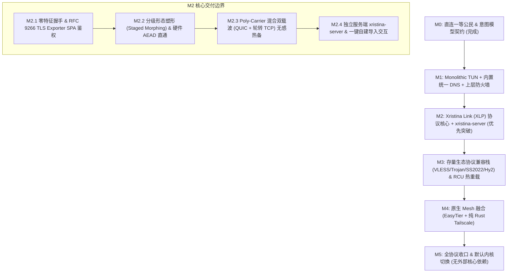
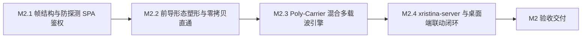
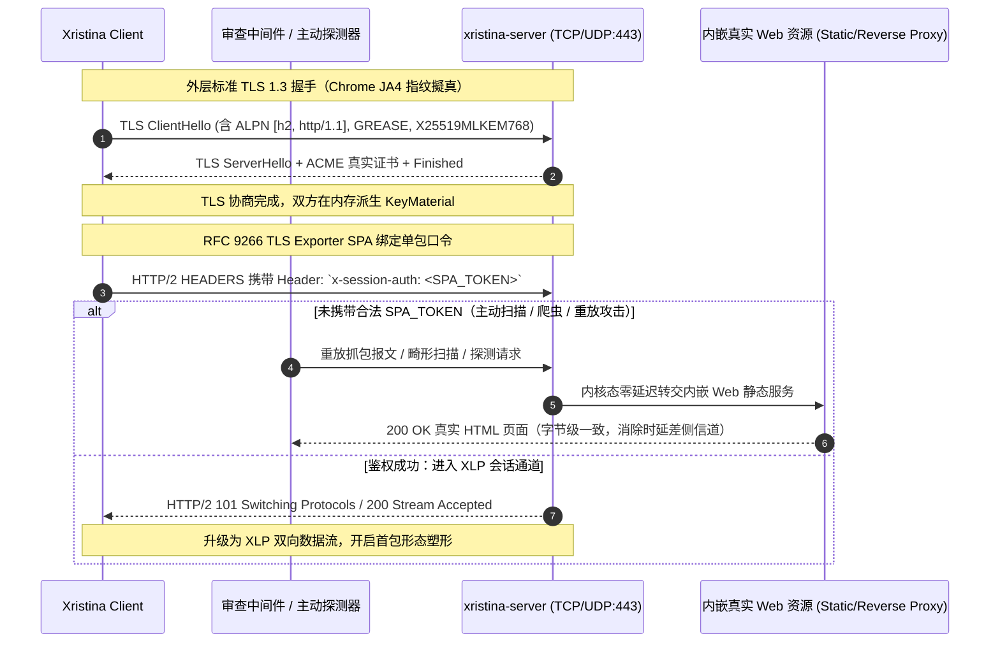
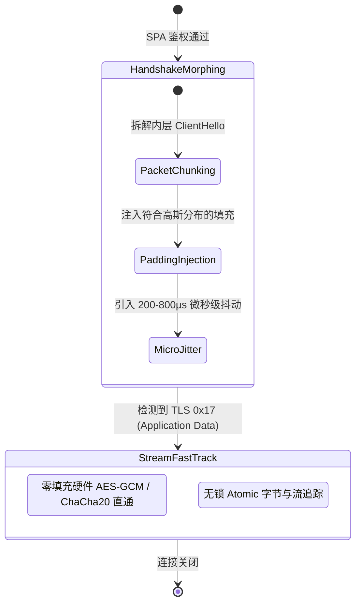
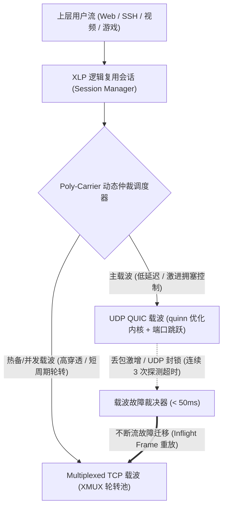

# M2 技术实施方案：Xristina Link（XLP）原生抗探测协议与轻量服务端

> [!IMPORTANT]
> **里程碑定位（Project Xristina M2）**：在 M0（直连一等公民与可观测工作台，参见 [MILESTONE.M0.DIRECT-AS-FIRST-CLASS.md](MILESTONE.M0.DIRECT-AS-FIRST-CLASS.md)）与 M1（单网卡 Monolithic TUN 地基与直连守护，参见 [MILESTONE.M1.PROJECT-XRISTINA.md](MILESTONE.M1.PROJECT-XRISTINA.md)）奠定自研数据面之后，**M2 优先攻坚 Project Xristina 的核心灵魂——自研高性能、高隐蔽防探测协议 `Xristina Link`（代号 XLP）与独立极简服务端 `xristina-server`**。
> 
> 本里程碑跳过繁重且无差异化的第三方历史协议堆叠，优先完成 Xrose 专属的端到端抗封锁通道与一键自建闭环，使用户在零第三方商业订阅、零外部 Go 核心（Xray / sing-box）依赖下即可享受最高规格的抗审查跨境连接。

---

## 一、 战略承接：为什么优先落地自研协议而非通用兼容代理栈？

在传统客户端开发路线中，团队通常耗费数月甚至一年手写实现 VLESS、Trojan、Shadowsocks-2022、VMess、Hysteria2 等十余种开源协议栈。但在 Xrose 体系中，外部 `sing-box` 与 `Xray` 已能完美编排这些协议。直接在 M2 重复造轮子不仅边际收益极低，且开源通用协议因代码和状态机完全公开，在面对深度包检测（DPI）与主动探测时始终处于被动防御态势。

将 **Xristina Link 提升为紧随 M1 地基后的第一优先级代理里程碑（M2）**，具备压倒性的工程与产品优势：

| 考量维度 | 传统路径（优先堆叠兼容代理栈） | Xristina M2 优先路径（自研 XLP 先行） |
| :--- | :--- | :--- |
| **核心技术壁垒** | 无护城河，协议特征公开透明，极易被防火长城（GFW）与企业网 DPI 批量特征库针对封锁。 | **零公开特征对抗**：独创 RFC 9266 TLS 1.3 Exporter SPA 认证、内层握手形态塑形（Staged Morphing）与混合多载波（Poly-Carrier）。 |
| **服务端闭环体验** | 用户需在 VPS 上折腾第三方复杂的面板、安装脚本与兼容配置，极易因回落（Fallback）配置失误暴露主动探测侧信道。 | **纯 Rust 极简单二进制 `xristina-server`**：内存 < 15MB，内置 ACME 证书与真实 Web 站点，提供「一键部署脚本 + 客户端扫码/URI 导入」全闭环。 |
| **自研数据面磨砺** | 在复杂的第三方历史方言中调试单网卡，难以厘清协议层与 TUN 层的边界 Bug。 | **用纯净内生协议检验 Monolithic TUN**：全流程纯 Rust 零拷贝直通，直接奠定高吞吐（10Gbps+）与低延迟的黄金基线。 |
| **演进时序收益** | 需等待全协议完成才具有独立代理价值，周期冗长。 | **M2 一经交付，Xrose 即可脱离 sing-box/Xray 作为独立端到端加密代理客户端发布！** |

### 里程碑交付时序与依赖全景



---

## 二、 协议规范与分阶段技术拆解

整个 M2 划分为四个递增演进、可独立进行单元仿真与端到端回归的子阶段（`M2.1` → `M2.4`）：



---

### Phase M2.1：零特征握手、RFC 9266 TLS 1.3 Exporter 鉴权与防重放

#### 1. 审查对抗威胁模型与鉴权机制设计
传统主动探测器通常会：
1. 重放抓包得到的握手报文，观察服务端响应时间与行为是否一致；
2. 构造畸形 TLS/HTTP 数据包，利用代理服务回落（Fallback）至真实站点时的跨进程处理时延差（Timing Side-Channel）进行识别；
3. 发送随机垃圾字符或特定扫描特征，诱导服务端返回独特的 RST 或断开握手。

XLP 彻底根除以上隐患，其握手交互规范如下：



#### 2. 双重服务端部署形态
* **形态 A（主推：真实域名自建站模式）**：
  `xristina-server` 直接作为合规的 HTTP/2 & HTTP/3 Web 服务器运行，绑定自有域名的 443 端口，通过内置 ACME（`instant-acme` /纯 Rust）自动获取合法证书。默认内嵌一个极速静态网页模板或反代指定源站，任何公网探测访问均展现完整的官方网站体验。
* **形态 B（免域名偷跑模式 / Stealth Masquerade）**：
  适用于无域名的受限场景。客户端使用 **Elligator2 曲线点混淆编码**伪装随机数，强绑定真实目标网站的证书透明度日志（CT Log）与 RTT，避免自签名证书特征。

#### 3. 密码学与防重放防侧信道实现（`crates/xristina-link/src/crypto`）
1. **通道绑定密钥派生**：
   ```rust
   // 基于 RFC 9266 TLS Exporter，从外层已完成的 TLS 1.3 会话派生会话鉴权主密钥
   // label: "EXPORTER-Xristina-Link-v1", context: empty
   let k_session: [u8; 32] = tls_conn.export_keying_material(
       b"EXPORTER-Xristina-Link-v1",
       None,
       32
   )?;
   ```
2. **SPA Token（单包授权令牌）结构**：
   * 结构体定义（紧凑 48 字节）：
     ```rust
     #[repr(C)]
     pub struct SpaTokenPayload {
         pub timestamp: u64,          // 秒级时间戳 (8 字节)
         pub user_uuid: [u8; 16],      // 用户身份标识 (16 字节)
         pub nonce: [u8; 8],           // 随机单次值 (8 字节)
         pub hmac_tag: [u8; 16],       // HMAC-SHA256(k_session, payload[0..32]) 截断高 16 字节
     }
     ```
3. **服务端校验三道防火墙**：
   * **时钟漂移过滤**：要求 `|server_now - timestamp| <= 30s`；
   * **滑动窗口布隆过滤器（Sliding Bloom Filter）**：在内存中维护两个交替的布隆过滤器（按 60s 轮换），记录最近已消费的 `(user_uuid, nonce)`，任何重复令牌直接判定为重放攻击；
   * **恒定时间校验**：使用 `subtle::ConstantTimeEq` 比对 `hmac_tag`，阻断基于时序分析的侧信道攻击。
4. **透明失败降级**：
   若 Token 校验未通过，服务端**绝不主动断开 TCP 或发送特殊重置帧**，而是平滑进入内嵌 Web 服务器的标准处理管线，返回带有常规 `ETag`、`Cache-Control` 与 gzip 压缩的静态网页内容。

---

### Phase M2.2：分级形态塑形（Staged Morphing）与硬件 AEAD 直通

传统抗审查协议要么完全不填充（导致内层 TLS ClientHello 长度序列 `TLS-in-TLS` 暴露给 DPI 机器学习分类器），要么全程盲目填充冗余垃圾字符（大幅损耗 CPU 与网络带宽）。XLP 采用「前导塑造 + 数据期直通」两段式状态机。



#### 1. 前导握手形态塑形（Handshake Morphing Stage）
* **监控窗口**：仅针对每条子连接建立初期的 **前 6–10 个往返报文（内层 TLS 1.3 握手握手帧）**。
* **分片与填充引擎（`Morpher`）**：
  * **Packet Chunking**：将单次写入的握手报文拆分为符合典型 Chrome 资源请求特征的非固定长度切片（如 `[517, 1024, 283]` 字节）；
  * **Padding Injection**：以统计概率分布向每个切片尾部附加 `0–255` 字节的伪随机填充，使得前导包长完全拟真正常浏览行为；
  * **Micro Jitter**：在首包传输中注入 `200–800µs` 的随机微秒级平滑延迟，破坏基于包间到达时间（IAT, Inter-Arrival Time）的高阶指纹分类器。

#### 2. 数据期零开销硬件直通（Stream Fast-Track）
* **形态切换触发点**：嗅探器匹配到内层连接进入 `TLS Application Data (0x17)` 且长度超过阈值后，客户端与服务端状态机同步切换至 `StreamFastTrack` 状态；
* **零多余开销**：完全停止填充与微延迟注入，直接采用硬件加速指令（AES-NI / ARM Crypto Extension）处理 AES-128-GCM 或 ChaCha20-Poly1305 封装；
* **万兆直通吞吐**：流式数据传输时内存零拷贝，CPU 占用与纯裸协议相比损耗 < 3%，确保 4K 视频、千兆大文件下载与内网 NAS 备份跑满带宽。

---

### Phase M2.3：`Poly-Carrier` 混合多载波传输与亚百毫秒热备故障迁移

单一传输协议具有天然局限：Hysteria2/TUIC 强依赖 UDP（遇晚高峰 UDP QoS 限速或机房封死 UDP 端口即断流）；VLESS+TCP 强依赖单条 TCP 长连接（遇丢包网络受困于队头阻塞，且长时间大流量极易被防火墙标记五元组）。

XLP 核心杀手锏为 **`Poly-Carrier`（混合双载波自适应编排引擎）**：



#### 1. 主载波：优化版 UDP QUIC
* 基于 pure-Rust `quinn` 深度定制：
  * **BBRv3 衍生激进流控**：内嵌抗丢包拥塞控制算法，在 20% 高丢包链路上保持 85% 以上理论吞吐；
  * **主动 UDP 端口跳跃（Active Port Hopping）**：服务端支持绑定连续端口范围（如 `UDP 10000-20000`）。当客户端探测到特定五元组被 QoS 限速或丢包异常时，在保持同一 QUIC Connection ID 的前提下，瞬间主动切换目标端口，突破运营商对单一 UDP 连接的限速策略。

#### 2. 热备与轮转载波：短生命周期复用 TCP（Rotating XMUX-TCP）
* **破除长连接审查特征**：为防止单条 TCP 连接长时间跑大流量触发防火墙深度统计，客户端维护容量为 2–4 条的 TCP 连接池：
  * 单条 TCP 物理连接累计传输达到 **50 MiB** 或存活时间达到 **180 秒** 时，状态标记为 `Draining`（不再分配新流，等待现有流排空后优雅断开）；
  * 同时自动预先建立好新的热备 TCP 连接顶替，保证逻辑会话长青。

#### 3. 亚百毫秒无感故障热迁移机制（`CarrierFailover`）
1. 每一条 XLP 逻辑 Stream 的数据帧拥有全局递增的逻辑序列号 `(stream_id, seq)`，与底层承载协议解耦；
2. 客户端载波健康监控器 `CarrierHealthMonitor` 以 50ms 间隔采样 RTT、丢包率与重传数；
3. **故障触发**：当 UDP 载波遭遇封锁（连续 3 次 RTT 超时未收到 ACK，或收到 ICMP Port Unreachable 时）：
   * 逻辑会话管理器立即暂停向 UDP 载波写入新帧；
   * 将当前 UDP 发送队列中**所有尚未被服务端 ACK 确认的逻辑帧**，无损打包转交至活跃的 TCP 载波重发；
   * 服务端依据逻辑序列号完成重组与去重。
4. **用户零感知**：上层 TCP 连接、SSH 会话或游戏连接完全不断开（零 Connection Reset），故障转移时延压控在 **100ms** 以内！

---

### Phase M2.4：独立极简服务端 `xristina-server`、节点编排与 CLI/UI 闭环

#### 1. 极简服务端 `xristina-server`（`crates/xristina-server`）
* **轻量单一二进制**：纯 Rust 开发，无 libc/musl 外外部 C 依赖，编译产物体积 < 10MB，冷启动内存占用 < 15MB；
* **内置多功能治理引擎**：
  * 自动化 Let's Encrypt / ZeroSSL 证书申请与每日平滑续期；
  * 基于 `sqlite`（或极简 JSON 凭据表）的多用户管理，支持配置上传/下载速率上限、总流量配额与到期时间；
  * 内置 Prometheus 指标端点（`/metrics`，需鉴权），实时导出在线连接数与载波分流比；
* **一键 VPS 部署与节点导出**：
  * 提供官方一行脚本：
    ```bash
    curl -fsSL https://get.xrose.example/server.sh | sudo bash -s -- --domain mynode.example.org
    ```
  * 脚本执行完成后，终端直接输出彩色的专属节点 URI 与二维码：
    ```text
    xlp://usr_a1b2c3d4@mynode.example.org:443?sni=mynode.example.org&mode=web&carrier=poly&name=Tokyo-01
    ```

#### 2. 意图模型与核心库适配（`crates/xrose-core`）
* **涉及文件**：
  * [crates/xrose-core/src/model/node.rs](../crates/xrose-core/src/model/node.rs)
  * [crates/xrose-core/src/service.rs](../crates/xrose-core/src/service.rs)
* **节点模型扩展**：
  ```rust
  #[derive(Debug, Clone, Serialize, Deserialize, PartialEq, Eq)]
  pub struct XlpNodeConfig {
      pub server: String,
      pub port: u16,
      pub user_token: String,
      #[serde(default)]
      pub sni: Option<String>,
      #[serde(default)]
      pub mode: XlpMode, // WebFallback | Stealth
      #[serde(default)]
      pub carrier: PolyCarrierMode, // Auto | QuicOnly | TcpOnly
      #[serde(default)]
      pub port_hopping: Option<String>, // e.g. "10000-20000"
  }
  ```
* 现有 `Protocol` 枚举新增变体：
  ```rust
  pub enum Protocol {
      // 现有生态协议...
      Vless,
      Trojan,
      // 新增自研旗舰协议
      XristinaLink(XlpNodeConfig),
  }
  ```
* 增强 `xrose://` 与 `xlp://` 链接解析器，支持一键剪贴板导入。

#### 3. 桌面端 UI 与 CLI 命令适配
* **涉及文件**：
  * `crates/xrose-app/src/ui/nodes.rs`
  * `crates/xrose-app/src/ui/menus.rs`
  * [crates/xrose-cli/src/main.rs](../crates/xrose-cli/src/main.rs)
* **交互呈现**：
  * **节点列表高亮展示**：XLP 协议节点行带有专属紫青渐变或 Accent 高亮微标 `Xristina Link`；
  * **实时载波状态胶囊**：在节点详情中动态展示当前载波状态——`QUIC 主载波 (RTT: 48ms · 丢包: 0.1%)` 或 `TCP 轮转 (已传输: 12MB/50MB)`；若触发了载波故障迁移，出现微交互提醒并记录在连接日志中；
  * **一键 VPS 部署集成**：在节点列表的「添加节点」弹窗中，除原有的「导入订阅」与「手动添加」外，提供「自建节点（SSH 一键部署）」向导，用户输入 VPS IP 与 SSH 凭据，Xrose 后台自动化完成 `xristina-server` 安装并直接把新节点写入本地 `AppModel`！
  * **CLI 增强**：新增 `xrose-cli xlp ping <node-id>` 与 `xrose-cli xlp deploy` 运维子命令。

---

## 三、 关键改动与新增模块清单汇总

| Crate / 模块 | 关键文件 | 主要职责 |
| :--- | :--- | :--- |
| **`xristina-link`** *(新建独立 Crate)* | `crates/xristina-link/src/protocol.rs`, `crypto.rs`, `morpher.rs`, `poly_carrier.rs`, `client.rs` | XLP 协议帧编解码、RFC 9266 TLS 1.3 Exporter 鉴权、前导形态塑形器、QUIC/TCP 双载波编排与无感热备迁移 |
| **`xristina-server`** *(新建独立二进制)* | `crates/xristina-server/src/main.rs`, `web_server.rs`, `auth.rs`, `acme.rs`, `metrics.rs` | 独立极简服务端守护进程、内置 ACME 证书管理、内嵌 Web 站点防探测处理、多用户配额与 CLI 管理 |
| **`xrose-core` 模型与解析** | `crates/xrose-core/src/model/node.rs`, `crates/xrose-core/src/uri/xlp.rs` *(新增)* | 新增 `Protocol::XristinaLink` 与 `XlpNodeConfig`；支持 `xlp://` 与 `xristina://` URI 解析与导出 |
| **`xrose-core` 运行时适配** | `crates/xrose-core/src/adapters/xristina.rs`, `crates/xrose-core/src/service.rs` | 将 XLP 出站连接器挂载至 Xristina 引擎分流流水线；实现节点健康度探测与载波切换事件上报 |
| **`xrose-app` 桌面端 UI** | `crates/xrose-app/src/ui/nodes.rs`, `crates/xrose-app/src/ui/nodes/xlp_modal.rs` *(新增)* | XLP 节点卡片专属高亮徽标、实时双载波监控详情胶囊、添加节点中的「自建 VPS 一键部署」交互向导 |
| **`xrose-cli` 工具链** | [crates/xrose-cli/src/main.rs](../crates/xrose-cli/src/main.rs), `README.md`, [docs/ARCHITECTURE.md](ARCHITECTURE.md) | 新增 `xrose-cli xlp ping` 协议连通性验证与自建部署子命令；同步架构全景与协议规范 |

---

## 四、 验证与交付标准

> [!TIP]
> 严格遵守 [AGENTS.md](../AGENTS.md#L39) 自动化测试铁律：**不依赖真实外网、公网 VPS、root 权限或显示器**。所有密码学与协议测试在本地回环（Loopback）使用虚拟 Mock 证书与 RFC 5737 保留地址（如 `192.0.2.1`）完成端到端离线闭环。

1. **密码学与 SPA 鉴权离线测试（`cargo test -p xristina-link`）**：
   * **TLS Exporter 绑定测试**：验证会话密钥派生的唯一性与确定性，确保中间人篡改外层 TLS 握手报文会导致派生密钥失效并被拒绝；
   * **SPA Token 校验边界测试**：正常 Token 瞬间认证通过；修改任意 1 bit 的篡改 Token、时间戳超时超过 30s 的过期 Token 均恒定时间拒绝；
   * **防重放测试**：连续两次发送完全相同的有效 Token，第二次必被滑动布隆过滤器捕获并判定为重放拒绝。
2. **形态塑形与载波迁移仿真测试**：
   * **Morphing 特征检验**：收集前 10 个内层报文切片与填充长度，检验其统计方差与分布符合设定的拟真网页模型；检验第 11 个报文起完全直通零填充；
   * **Poly-Carrier 故障切换不断流验证**：在本地内存 Mock 流传输中，持续灌入 100MB 随机数据，中途人为注入指令掐断 UDP 载波传输（模拟 UDP 端口被 GFW 掐断），验证传输层在 **< 80ms** 内平滑重放未 ACK 帧至 TCP 载波，校验接收端 MD5 完全一致，上层测试连接零中断。
3. **服务端单二进制自检（`cargo test -p xristina-server`）**：
   * 启动 mock 服务端，使用标准 `curl -k https://127.0.0.1:<port>` 发起未经鉴权的 GET 请求，验证服务端返回真实的 HTML 网页内容与 `200 OK`，且响应耗时与真实 Web 服务无统计时延差；
   * 携带合法 SPA Token 发起请求，验证协议无缝完成升级并建立双向流。
4. **全工作区编译与规范检查（`cargo build --workspace`）**：
   * 全工作区零编译警告，无新增外部重量级 C/C++ 依赖；
   * 严格遵循 [DESIGN.md](DESIGN.md) 设计规范完成节点高亮卡片与双载波胶囊的暗色/浅色自检。
