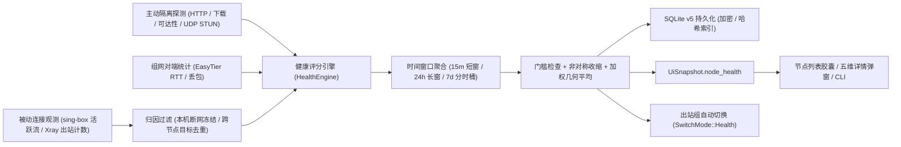
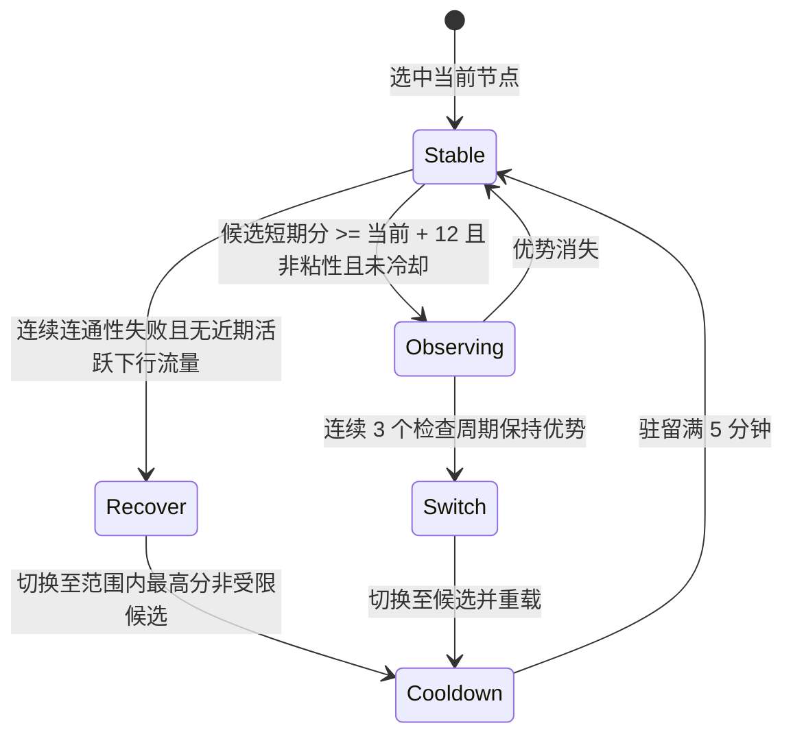

# Xrose 节点健康度评分机制设计

本文档定义 Xrose 节点与出口（含本机直连、代理节点与异地组网出口）的五维健康度评分模型、双内核观测边界、归因过滤、可达性检测、自动切换状态机、存储结构及 UI 规范。

---

## 1. 设计原则

1. **可解释优先**：任意节点的综合得分均可下钻至各维度得分、原始测量值、扣分原因与硬门槛状态。
2. **短板惩罚**：使用加权几何平均与硬门槛封顶，防止单一维度严重劣化（如高丢包或服务受限）被其他维度的高分掩盖。
3. **主被动融合与双内核兼容**：主动隔离探测保障双内核（`sing-box` 与 `Xray`）评估口径一致与冷启动可测；`sing-box` 活跃流连接提供零流量开销的被动吞吐与异常观测；预留 `ErrStage` / `CloseKind` 字段以平滑承接 [Project Xristina](MILESTONE.M1.PROJECT-XRISTINA.md) 引擎原生流遥测。
4. **准确归因**：通过本机断网冻结保护与跨节点内存同源故障去重，避免将本机断网或目标站自身故障误计入节点扣分。
5. **流量受控**：被动大连接吞吐优先于主动下载测速；后台自动探测受每日主动探测流量上限约束。
6. **非对称置信度收缩**：仅对样本不足的高分向保守先验（`75` 分）收缩，绝不因样本少而向上抬高失败或低分节点。

---

## 2. 数据流

---

## 3. 五个评分维度

每个可测出口均按 `HttpTestTarget::key()` 标识（本机直连为 `__xrose_direct__`，代理节点为 `<node_id>`，组网出口为 `mesh-http:<profile_id>:<peer_id>`），按以下五个维度计算 `0–100` 子分：

| 维度 | 代号 | 衡量目标 | 主要输入信号 |
| --- | --- | --- | --- |
| 可用性 | **A** | 连接能否建立与保持 | 端到端主动探测成功率 `p_probe`、被动有效连接成功率 `p_conn` |
| 延迟 | **L** | 首包与交互响应速度 | HTTP 延迟 `P50` / `P90`（或组网对端 RTT） |
| 稳定性 | **S** | 链路波动与丢包程度 | 延迟抖动率、UDP / 组网丢包率、被动异常短连接率 |
| 吞吐 | **T** | 持续传输带宽能力 | 被动大流量连接（`> 2 MiB`）实测峰值 `P75`、主动下载测速 |
| 可达性 | **R** | 落地出口场景可用性 | AI 服务、流媒体解锁、公共搜索免验证与 SOCKS5 UDP 能力 |

### 3.1 可用性 `A`

- **主动成功率 `p_probe`**：以端到端主动探测（`HTTP` / `Download` / `Reachability` / `MeshPeer`）的时间衰减成功率为主。纯 TCP 握手（`Tcp`）可能在中转入口提前应答，仅作为无 HTTP 样本时的参考，置信度封顶 `0.25`。
- **被动成功率 `p_conn`**：仅统计经归因过滤后的真实连接（例如 `sing-box` 中持续极短、零下行接收或带节点拨号/TLS 失败日志记录的连接）。
- **融合与强惩罚映射**：

$$
p = \lambda \cdot p_{\text{conn}} + (1 - \lambda) \cdot p_{\text{probe}}, \qquad \lambda = \min\!\left(0.70,\ \frac{n_{\text{conn}}}{200}\right)
$$

$$
s_A = 100 \cdot \operatorname{clamp}\!\left(\frac{p - p_{\min}}{1 - p_{\min}},\ 0,\ 1\right)^2, \qquad p_{\min} = 0.80
$$

当主动与被动融合可用率降至 `80%` 及以下时，`s_A = 0` 并触发严重不稳定硬门槛。

### 3.2 延迟 `L`

混合使用近期成功样本的 `P50` 与 `P90`：

$$
L = 0.60 \cdot P_{50} + 0.40 \cdot P_{90}
$$

按对数尺度归一化（对齐 Xrose 现有的 `120 / 500 / 1000 ms` 延迟分级）：

$$
s_L = 100 \cdot \operatorname{clamp}\!\left(\frac{\ln L_{\text{bad}} - \ln L}{\ln L_{\text{bad}} - \ln L_{\text{good}}},\ 0,\ 1\right)
$$

| 测量类型 | `L_good` | `L_bad` |
| --- | --- | --- |
| 代理 / 直连 HTTP 延迟（`generate_204`） | `150 ms` | `1500 ms` |
| 组网对端 RTT | `30 ms` | `300 ms` |

### 3.3 稳定性 `S`

由可用子项按存在权重重新归一化后算术合成：

1. **抖动率（权重 `0.40`）**：取相邻成功探测 RTT 差值的绝对均值 `jitter`，分母使用 `80 ms` 托底以避免超低延迟节点因微小波动被高估抖动：
   $$
   r_J = \frac{\text{jitter}}{\max(P_{50},\ 80\text{ ms})}, \qquad s_{\text{jitter}} = 100 \cdot \operatorname{clamp}\!\left(1 - \frac{r_J}{0.50},\ 0,\ 1\right)
   $$
2. **丢包率（权重 `0.30`，存在 UDP / 组网统计时计入）**：$s_{\text{loss}} = 100 \cdot \exp(-\text{loss} / 0.03)$。
3. **被动异常断开率（权重 `0.30`，`n_conn >= 10` 时计入）**：统计非正常零接收短连接比例 `rate`，$s_{\text{drop}} = 100 \cdot \exp(-\text{rate} / 0.04)$。

### 3.4 吞吐 `T`

- 优先取最近 24 小时内传输超过 `2 MiB` 的真实连接峰值下行速率 `P75`（零额外探测流量）；若无符合条件的被动样本，则回退采用主动下载测速的 `bytes_per_second`。
- 均缺失时省略 `T` 维度并重归一化其余维度权重。

$$
s_T = 100 \cdot \operatorname{clamp}\!\left(\frac{\ln(T / T_{\text{low}})}{\ln(T_{\text{high}} / T_{\text{low}})},\ 0,\ 1\right), \qquad T_{\text{low}} = 500\text{ KB/s},\ T_{\text{high}} = 20\text{ MB/s}
$$

### 3.5 可达性 `R`（AI / 流媒体 / 出口环境）

可达性探测复用单次隔离测试内核（`compile_reachability_probe` 同时暴露本地 HTTP 与支持 UDP 的 SOCKS5 回环入站），先解析落地出口 IP 并以本机 `SecretBox` 派生密钥计算 `keyed_hash("egress-v1", egress_ip)`：
- **同出口共享缓存**：命中 6 小时内有效缓存时直接复用检测结果（`UdpStun` 仍按节点独立保留）。
- **被动与合规限制**：所有检测均为无 Cookie、不带账号凭据、禁止自动重定向的单次轻量 HTTP 或 RFC 5389 STUN 绑定请求。遇到 `403`、`429`、地区拦截重定向或反爬/人机验证响应头（如 `cf-mitigated`、`/sorry/`）时立即停止并记为 `Limited` 或 `Blocked`，绝不重试或绕过验证机制。

三套子评估集构成如下：

1. **AI 服务集（`R_ai`）**：
   - `ChatGPT / OpenAI`（`0.35`）：正常可达 `100` / 需人机验证或限流 `40` / 地区封禁 `0`
   - `Claude / Anthropic`（`0.30`）：正常可达 `100` / 需人机验证或限流 `40` / 封禁 `0`
   - `Google Gemini`（`0.25`）：支持地区可达 `100` / 地区受限 `40` / 不可达 `0`
   - `GitHub Copilot`（`0.10`）：端点可达 `100` / 拦截或失败 `0`
2. **流媒体解锁集（`R_media`）**：
   - `Netflix`（`0.40`）：完整非自制剧解锁 `100` / 仅自制剧 `50` / 不可用 `0`
   - `YouTube Premium`（`0.25`）：支持区域正常 `100` / 区域受限或地区误判 `40` / 不可达 `0`
   - `Disney+`（`0.20`）与 `TikTok`（`0.15`）：解锁 `100` / 受限 `0`
3. **通用环境与协议集（`R_general`）**：
   - 公共搜索与 CDN 免验证（`0.35`）：免验证 `100` / 需人机验证 `50` / 不可达 `0`
   - 谷歌学术（`Google Scholar`，`0.20`）：正常可达 `100` / 需人机验证 `50` / 封禁或不可达 `0`
   - 开发服务（`GitHub`，`0.20`）：可达 `100` / 限流 `50` / 失败 `0`
   - 真 UDP 转发（经本地 SOCKS5 `UDP ASSOCIATE` 发送 STUN Binding Request，`0.25`）：收到映射响应 `100` / 失败或节点未启用 UDP `0`

按当前评估场景选择对应的 `R` 映射：
- `General`：`0.40 * R_ai + 0.35 * R_media + 0.25 * R_general`
- `Ai`：`R_ai`
- `Streaming`：`R_media`
- `LowLatency`：`0.40 * R_general + 0.60 * UDP_STUN`
- `Bulk`：`R_general`
- `MeshExit`：不计入 `R`（权重重归一化）

---

## 4. 硬门槛（Gate）

计算几何平均后强制检查硬门槛；命中时封顶展示分与短窗分，并展示对应中文原因标签。**硬门槛仅作用于评分封顶与非粘性主动优选，绝不会触发配置热重载或阻断用户继续使用当前节点**：

| 条件 | 分数上限 | 状态标签 |
| --- | :---: | --- |
| 最近连续 3 次主动探测全失败且最近 2 分钟无活跃或成功被动连接 | `10` | 不可用 |
| 检测到 TLS / 证书 / Reality 校验异常 | `20` | 安全异常 |
| 融合可用率 `p < 80%`（需至少 3 次主动探测且近 2 分钟无活跃流量） | `30` | 严重不稳定 |
| 专用场景（`Ai` / `Streaming`）已测但核心必需项全阻断，或 `LowLatency` 下 UDP 不可用 | `40` | 服务受限 |

---

## 5. 非对称置信度收缩、加权几何平均与场景权重

### 5.1 非对称收缩

定义有效样本单位：$n_{\text{eff}} = n_{\text{active}} \cdot 1.0 + n_{\text{passive}} \cdot 0.05$，总体置信度为：

$$
c = 1 - \exp\!\left(-\frac{n_{\text{eff}}}{5.0}\right)
$$

对各维度得分 $s_i$ 仅在 $s_i > 75$ 时向保守先验 $s_{\text{prior}} = 75$ 收缩（$n_0 = 2.0$）：

$$
\hat{s}_i = \begin{cases} \dfrac{n_{\text{dim}} \cdot s_i + 2.0 \cdot 75.0}{n_{\text{dim}} + 2.0}, & s_i > 75 \\[6pt] s_i, & s_i \le 75 \end{cases}
$$

该设计既避免了仅测速 1 次就给出满分，也避免了虚拟失败注入导致的「100% 全成功节点无法达到 A 级」及「首次失败被拉高」问题。

### 5.2 加权几何平均与六大场景预设

对当前存在的维度子集 $\mathcal{D}$ 重归一化权重 $\tilde{w}_i$：

$$
H = \min\!\left(\text{GateCap},\ \prod_{i \in \mathcal{D}} \max(\hat{s}_i,\ 1)^{\tilde{w}_i}\right)
$$

| 场景预设（`HealthProfile`） | `A` | `L` | `S` | `T` | `R` | 默认特性 |
| --- | :---: | :---: | :---: | :---: | :---: | --- |
| `General`（通用，默认） | `0.30` | `0.20` | `0.20` | `0.15` | `0.15` | 综合日常访问 |
| `Ai`（AI 服务） | `0.25` | `0.15` | `0.20` | `0.05` | `0.35` | 默认开启**会话粘性** |
| `Streaming`（流媒体） | `0.20` | `0.05` | `0.20` | `0.30` | `0.25` | 侧重解锁与码率承载 |
| `LowLatency`（低延迟） | `0.25` | `0.35` | `0.30` | `0.05` | `0.05` | 侧重 `P90`、抖动与真 UDP |
| `Bulk`（大流量） | `0.25` | `0.10` | `0.20` | `0.40` | `0.05` | 侧重持续吞吐峰值 |
| `MeshExit`（组网出口） | `0.30` | `0.25` | `0.30` | `0.15` | `0.00` | 适应组网对端测量 |

### 5.3 五档等级与配色规范

颜色映射严格遵循 [DESIGN.md](DESIGN.md) 的语义 Token，字母等级始终与颜色同时出现：

| 分数区间 | 等级 | 说明 | 视觉 Token |
| --- | :---: | --- | --- |
| `85–100` | **A** | 优秀 | `ok_text` + `success (14%)` 浅底 |
| `70–84` | **B** | 良好 | `fg` 正文色 + `panel_alt` 底 |
| `50–69` | **C** | 一般 | `warn_text` + `warning (14%)` 浅底 |
| `30–49` | **D** | 较差 | `danger_text` + `danger (14%)` 浅底 |
| `0–29` | **F** | 不可用 | `danger_text` + `danger (14%)` 浅底 |

---

## 6. 时间窗口与 24 小时晚高峰画像

- **短窗（半衰期 `15 min`）**：反映节点即时状态，专门用于自动切换决策。
- **长窗（半衰期 `24 h`）**：结合近 24 小时探测与分时桶反映稳定表现。
- **展示综合分**：$H_{\text{display}} = 0.40 \cdot H_{\text{short}} + 0.60 \cdot H_{\text{long}}$（仍受当前硬门槛封顶）。
- **7 天分时桶与晚高峰检测**：按本地自然时（`0–23` 时）汇总近 7 天加权成功率、`P50` / `P90` 延迟与 `P75` 吞吐。当连续 3 天及以上存在记录，且某连续 2–4 小时时段的平均延迟超过全天中位数 `50%` 以上时，生成「晚高峰劣化」诊断提示（如 `每天 20:00–23:00 延迟平均上升 140%`）。

---

## 7. 归因过滤与每日探测流量上限

1. **本机断网冻结**：当 `15 秒` 内连续 `3` 个以上不同出口同时出现网络/超时失败且无任何成功样本时，判定为本机断网或上游波动，冻结失败扣分直至任意目标恢复连通。
2. **跨节点同源目标去重**：内存中使用带进程随机盐的 `Sha256` 截断哈希记录 5 分钟内跨节点的目标失败；同一目标哈希在 2 个及以上节点/直连均失败时，豁免被动连接失败惩罚，**绝不将任何用户访问域名写入磁盘**。
3. **每日探测流量上限**：`Settings.daily_probe_budget_mb`（默认 `100 MiB`，`0` 表示不限）按自然日累计主动探测流量消耗；超限后暂停自动切换与后台轮询探测，仍允许用户显式手动测速。

---

## 8. 自动切换状态机（`SwitchMode::Health`）

健康检查与评分全流程独立于内核配置，**绝不触发配置热重载**，也不会因低分或硬门槛强行中断用户正在正常使用的节点。

- **粘性会话（`sticky_session`）**：开启后仅在连续连通性失败（且无近期活跃流量）时触发回退，绝不因分差或硬门槛主动切换可用节点，避免 AI 等会话敏感服务因出口 IP 频繁跳变触发风控。
- **可审计切换提示**：触发切换时在提示消息中明确原节点、目标节点及短窗分数变化。

---

## 9. 存储与 UI 呈现

### 9.1 SQLite v5 存储

持久化版本升级至 `SCHEMA_VERSION = 5`（[schema_v1.sql](../crates/xrose-core/src/storage/schema_v1.sql) 与 [storage/health.rs](../crates/xrose-core/src/storage/health.rs)），新增 4 张只含数值、状态与脱敏摘要的表：
- `health_probe_samples`：每个目标保留最近 50 条主动探测样本。
- `health_reachability_cache`：以 `SecretBox::keyed_hash` 加密索引出口 IP，载荷经 `SecretBox` 加密。
- `health_target_reachability`：记录目标关联的脱敏出口摘要与独立 UDP STUN 状态。
- `health_hourly_buckets`：保留近 7 天（168 小时）按时归档统计。

删除节点、修改节点参数、删除订阅或删除组网配置时同步清理关联的健康记录。

### 9.2 界面呈现（原型 A）

- **节点列表行**：在下载速度与 HTTP 延迟列之间放置固定 `56px` 宽健康胶囊（例如 `[A 94]`）；置信度 `< 0.4` 或距最近测速/活跃流量超过 `10 分钟` 时以 `0.45` 透明度淡化；副信息行补充精简纯文本摘要（如 `AI 4/4 · NF全解锁 · UDP`），隐私模式下隐藏地区码。
- **工具栏排序**：提供 5 项分段选择 `顺序 | 健康 ↓ | AI ↓ | 流媒体 ↓ | 延迟 ↑`，切换为 `AI ↓` / `流媒体 ↓` 时右侧胶囊优先展示对应场景分。
- **健康详情弹窗**：点击胶囊或节点菜单「健康度详情…」打开弹窗，展示综合等级、置信度、硬门槛警示、五维 `8px` 水平进度条、AI/流媒体/环境明细、主要扣分项、24 小时分时热力条以及单节点重测动作。
